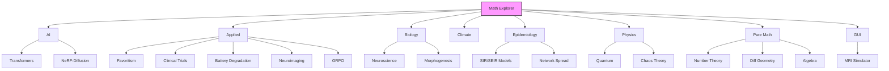
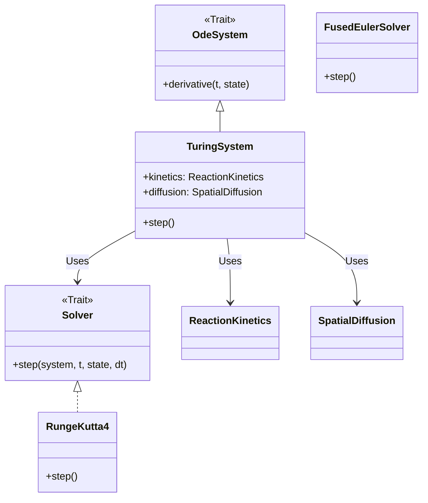

# Math Explorer


**Math Explorer** is a comprehensive Rust library that bridges the gap between rigorous academic theory and executable code. From simulating Quantum Mechanics to modeling Social Favoritism, this repository serves as a verifiable playground for complex algorithms.

> **"Code explains HOW; Docs explain WHY."**

---

## Install

```bash
git clone https://github.com/fderuiter/OxidizeMath.git
cd OxidizeMath

# Check prerequisites, build the core library, run tests, and automatically configure Git hooks
# Note: To compile academic papers, ensure Tectonic is installed.
# Install Tectonic 0.15.0:
# curl -sL "https://github.com/tectonic-typesetting/tectonic/releases/download/tectonic%400.15.0/tectonic-0.15.0-x86_64-unknown-linux-gnu.tar.gz" | tar xz
# sudo mv tectonic /usr/local/bin/
cargo run -p xtask -- setup
```

Alternatively, you can manually build the library using Cargo:

```bash
# Build the core library manually
cargo build --release --package math_explorer
```

**Note:** The setup process automatically installs Git hooks that enforce project standards (e.g., file-length constraints in core directories) at the commit level. This provides immediate local feedback and prevents compliance bypasses without manual intervention.

## Usage

### Quickstart: "Hello World"
Experience the library in action by running our pre-built Quantum Mechanics example within 30 seconds of installation:

```bash
cargo run --package math_explorer --example hello_world
```

### 1. The Interactive GUI (Recommended)
We provide a native eframe/egui application to explore simulations (Physics, Biology, Chaos Theory, etc.) interactively.

> **See the [Math Explorer GUI Documentation](math_explorer_gui/README.md) for architecture details and contribution guides.**

```bash
cargo run --release --package math_explorer_gui
```

#### Current Capabilities
*   **Physics / MRI:** Bloch Simulator with real-time control over $T_1$, $T_2$, $\vec{B}$-field, and magnetization vectors.
*   **Physics / Fluid Dynamics:** Potential Flow visualization, Turbulence/Reynolds Number analysis, and interactive Lattice Boltzmann (LBM) flow simulation.
*   **Physics / Medical:** Dose Calculation (2D Heatmap of radiation dose distribution).
*   **Physics / Chaos:** Attractor Plotter (Lorenz, Rossler), Bifurcation Diagrams, and Fractal Generator.
*   **Physics / Quantum:** Schrödinger Solver, Wavefunction Evolution, and Clebsch-Gordan Calculator.
*   **Physics / Solid State:** Crystal Lattice Viewer (FCC, BCC, SC).


### Deep Dive: Modules

The modules are organized into high-level domains, each solving specific problems:



| Domain | Module | Description |
| :--- | :--- | :--- |
| ** AI** | `math_explorer::ai` | Transformers (Attention, Encoders), **Reinforcement Learning** (Q-Learning), NeRF-Diffusion (SDS), and Self-Calibration loops. |
| ** Applied** | `math_explorer::applied` | **Favoritism** (Satirical modeling), **Clinical Trials** (Win Ratio), **Battery Degradation** (Li-ion), **Isosurface** (Marching Cubes), **LoraHub**, **Neuroimaging**, and **GRPO** (Policy Optimization). |
| ** Biology** | `math_explorer::biology` | **Neuroscience** (Hodgkin-Huxley), **Morphogenesis** (Turing Patterns), **Generic Reaction-Diffusion**, and **Evolutionary Dynamics**. |
| ** Climate** | `math_explorer::climate` | **CERA Framework** (Climate-invariant Encoding through Representation Alignment). |
| ** Epidemiology** | `math_explorer::epidemiology` | **Compartmental Models** (SIR/SEIR), **Network Spread**, and **Stochastic Dynamics**. |
| ** Physics** | `math_explorer::physics` | Quantum Mechanics (Clebsch-Gordan), Astrophysics, Chaos Theory (Lorenz System), and Fluid Dynamics. |
| ** Pure Math** | `math_explorer::pure_math` | **FRACTRAN** (Algorithmic Info), **Statistics** (Glicko-2, Markov, TDA), **Tensors** (Christoffel Symbols), Number Theory, Graph Theory, and **Abstract Algebra**. |
| ** GUI** | `math_explorer_gui` | Interactive **eframe/egui** application for visualizing simulations (currently MRI Physics). |

To maintain flexibility and testability across domains, Math Explorer relies heavily on the Strategy Pattern. This allows users to swap numerical solvers, diffusion models, or reaction kinetics without changing the core system logic.



### 3. Comprehensive Examples

Explore 20+ specialized, runnable examples spanning Physics, AI, Biology, and Pure Math.

> **See the [Examples Catalog](math_explorer/examples/README.md) for the full list of simulations and their commands.**

---

## Config

Math Explorer uses standard Cargo features to manage compilation of its extensive domain modules. By default, no specific domain features are enabled.

To selectively compile domains (e.g., `physics` and `ai`), update your `Cargo.toml`:

```toml
[dependencies]
math_explorer = { version = "0.4.0", features = ["physics", "ai"] }
```

Available feature flags include: `ai`, `applied`, `biology`, `climate`, `epidemiology`, `physics`, and `pure_math`.


---

## Architecture Documentation

For detailed system architecture, runtime constraints, and simulation guides, explore the [Centralized Architecture Guide Suite](docs/architecture/README.md):

*   **[System Overview & Crate Topology](docs/architecture/system_overview.md):** 5-layer system design, crate dependency graphs, and catalog of all 18 crates.
*   **[CERA Framework Guide](docs/architecture/cera_framework.md):** Climate-invariant encoding, representation alignment pipelines, and Earth Mover's Distance loss.
*   **[Zero-Allocation Runtime Guide](docs/architecture/zero_allocation_runtime.md):** NASA Power of 10 Rule 3 enforcement, `VerifiedAllocator`, and `VerifiedEngine` runtime metrics.
*   **[Interactive Tool Walkthrough](docs/architecture/interactive_tool_walkthrough.md):** Contributor onboarding tutorial to build and register interactive simulation tabs.
*   **[Documentation Index](docs/README.md):** Primary documentation index linking to the architecture suite and historical decisions.

---

## Contributing

We welcome contributions! Please see [CONTRIBUTING.md](CONTRIBUTING.md) for our style guide and process.

**The Golden Rule:** If you add code, you must add documentation and tests.

To verify the integrity of all mathematical implementations:

```bash
# Run tests across all workspace member crates
cargo test --workspace
```

### License

This project is open-source. See the [LICENSE](LICENSE) file for details.
