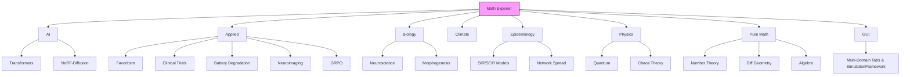
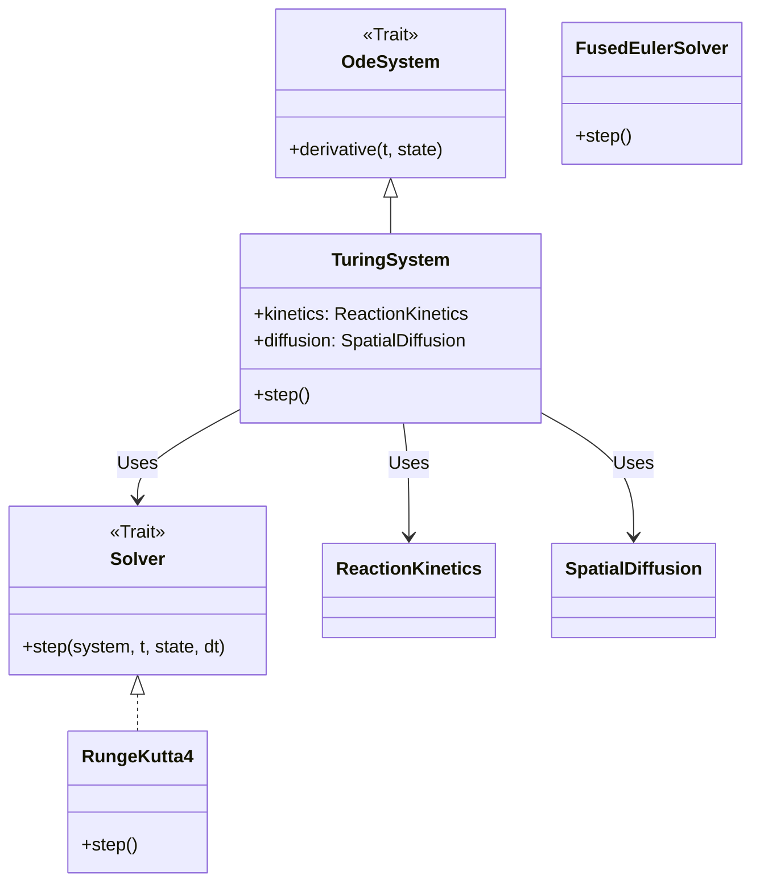

# Math Explorer


**Math Explorer** is a comprehensive Rust library that bridges the gap between rigorous academic theory and executable code. From simulating Quantum Mechanics to modeling Social Favoritism, this repository serves as a verifiable playground for complex algorithms.

> **"Code explains HOW; Docs explain WHY."**

---

## Install

```bash
git clone https://github.com/fderuiter/OxidizeMath.git
cd OxidizeMath

# Configure Git hooks (.githooks/pre-commit and .githooks/pre-push), check prerequisites, and run cargo check --workspace
# (Pass `--hooks-only` to configure hooks immediately, or `--web` to enforce WASM/Playwright browser tools)
# Note: To compile academic papers (`cargo run -p xtask -- compile-papers`), ensure TeXLive `pdflatex` and `bibtex` are installed:
# sudo apt-get install -y texlive-latex-base texlive-latex-recommended texlive-fonts-recommended texlive-latex-extra texlive-science texlive-binaries
cargo run -p xtask -- setup
```

Alternatively, you can manually build the library using Cargo:

```bash
# Build the core library manually
cargo build --release --package math_explorer
```

**Note:** `cargo run -p xtask -- setup` configures version-controlled Git hooks with executable permissions (`.githooks/pre-commit` and `.githooks/pre-push`) first, adds the `wasm32-unknown-unknown` target, warns if optional browser tools are absent (use `--web` to require them or `--hooks-only` for instant hook setup), and runs `cargo check --workspace` (unless `--check-only` is passed). At commit time, `.githooks/pre-commit` runs `cargo run -p xtask -- lint-staged` scoped to staged files and directly touched crates for fast offline feedback, while `.githooks/pre-push` runs `cargo run -p xtask -- lint-push` for offline reverse-dependent host/`wasm32` Clippy and full workspace traceability before pushing. Before opening or updating a pull request, run `cargo run -p xtask -- lint-all` to execute the full workspace verification suite.

## Usage

### Quickstart: "Hello World"
Experience the library in action by running our pre-built Quantum Mechanics example within 30 seconds of installation:

```bash
cargo run --package math_explorer --features physics --example hello_world
```

### 1. The Interactive GUI (Recommended)
We provide a native eframe/egui application to explore simulations (Physics, Biology, Chaos Theory, etc.) interactively.

> **See the [Math Explorer GUI Documentation](math_explorer_gui/README.md) for architecture details and contribution guides.**

```bash
cargo run --release --package math_explorer_gui
```

#### Current Capabilities
*   **Physics / MRI:** Bloch Simulator with real-time control over $T_1$, $T_2$, $\vec{B}$-field, and magnetization vectors.
*   **Physics / Fluid Dynamics:** Potential Flow visualization, Turbulence/Reynolds Number analysis, and interactive Lattice Boltzmann (LBM) flow simulation.
*   **Physics / Medical:** Dose Calculation (2D Heatmap of radiation dose distribution).
*   **Physics / Chaos:** Attractor Plotter (Lorenz, Rossler), Bifurcation Diagrams, and Fractal Generator.
*   **Physics / Quantum:** Schrödinger Solver, Wavefunction Evolution, and Clebsch-Gordan Calculator.
*   **Physics / Solid State:** Crystal Lattice Viewer (FCC, BCC, SC).
*   **Game Theory:** Evolutionary Replicator Dynamics and Bayesian Glicko-2 Tournament Simulator ($r \pm 2\,\text{RD}$ confidence bands, $\sigma$ volatility shifts, Swiss & Round-Robin pairings, and frozen-vs-sequential drift).


### Deep Dive: Modules

The modules are organized into high-level domains, each solving specific problems:



| Domain | Module | Maturity | Description |
| :--- | :--- | :--- | :--- |
| ** AI** | `math_explorer::ai` | `Validated` | Transformers (Attention, Encoders), **Reinforcement Learning** (Q-Learning), NeRF-Diffusion (SDS — `Experimental`), and Self-Calibration loops. |
| ** Applied** | `math_explorer::applied` | `Validated` | **Clinical Trials** & **Pharmacokinetics** (`Certified`); **Win Ratio**, **Battery Degradation**, **Isosurface**, & **Neuroimaging** (`Validated`); **Favoritism**, **LoraHub**, & **GRPO** (`Experimental`). |
| ** Biology** | `math_explorer::biology` | `Validated` | **Neuroscience** (Hodgkin-Huxley) & **Morphogenesis** (`Certified`); **Reaction-Diffusion** & **Evolutionary Dynamics** (`Validated`). |
| ** Climate** | `math_explorer::climate` | `Experimental` | **CERA Framework** (Climate-invariant Encoding through Representation Alignment research prototype). |
| ** Epidemiology** | `math_explorer::epidemiology` | `Validated` | **Compartmental Models** (SIR/SEIR), **Network Spread**, and **Stochastic Dynamics**. |
| ** Physics** | `math_explorer::physics` | `Validated` | **Quantum Mechanics**, **Chaos Theory**, & **Abelian Sandpile** (`Certified`); **Astrophysics**, **Fluid Dynamics**, **MRI**, & **Optics** (`Validated`); **Nuclear** & **Solid State** (`Experimental`). |
| ** Pure Math** | `math_explorer::pure_math` | `Certified` | **ODE / Root / Wave2D Solvers**, **Abstract Algebra**, **Number Theory**, & **Elliptic Curves** (`Certified`); **Statistics** & **Differential Geometry** (`Validated`). |
| ** GUI** | `math_explorer_gui` | `Validated` | Interactive **eframe/egui** desktop and WebAssembly workbench surfacing per-tool `MaturityTier` badges across `SimulationFramework`, `Theory Context Portal`, and `TraceabilityTab`. |

#### Maturity Tiers & Qualification Gates

Every registered mathematical crate and `[links]` module in `traceability.toml` carries an explicit [`MaturityTier`](crates/scientific_metadata/src/theory.rs) (`Experimental`, `Validated`, or `Certified`) enforced by `cargo run -p xtask -- check-maturity` and `api_drift`:

| Tier | Badge | Required Evidence | API & SemVer Policy |
| :--- | :--- | :--- | :--- |
| **Experimental** | `[EXP]` | Compiles cleanly with explicit `[crates]` / `[modules]` registration (safe default for `Cera` and `favoritism`). | Fluid research iteration permitted without baseline bumps. |
| **Validated** | `[VAL]` | Non-stub functions, assertion density `>= 0.40` asserts/fn, seeded `OxidizeRng` / `ChaCha8Rng` determinism, and golden reference fixtures. | Tracked in `api_baseline.json`. |
| **Certified** | `[CERT]` | All `Validated` gates plus non-vacuous deterministic `theory_verification!` contracts and `VerifiedAllocator` / `VerifiedEngine::run_verified` zero-allocation proofs. | SemVer-locked: removing public signatures requires bumping `[workspace.package].version`. |

To maintain flexibility and testability across domains, Math Explorer relies heavily on the Strategy Pattern. This allows users to swap numerical solvers, diffusion models, or reaction kinetics without changing the core system logic.



### 3. Comprehensive Examples

Explore 32 specialized, runnable examples spanning AI, Applied Math, Biology, Climate, Epidemiology, Physics, and Pure Math.

> **See the [Examples Catalog](math_explorer/examples/README.md) for the full list of simulations and their commands.**

---

## Config

Math Explorer uses standard Cargo features to manage compilation of its extensive domain modules. By default, no specific domain features are enabled.

To selectively compile domains (e.g., `physics` and `ai`), update your `Cargo.toml`:

```toml
[dependencies]
math_explorer = { version = "0.4.0", features = ["physics", "ai"] }
```

Available feature flags include: `ai`, `applied`, `biology`, `climate`, `epidemiology`, `physics`, and `pure_math`.


---

## Architecture Documentation

For detailed system architecture, runtime constraints, and simulation guides, explore the [Centralized Architecture Guide Suite](docs/architecture/README.md):

*   **[System Overview & Crate Topology](docs/architecture/system_overview.md):** 5-layer system design, crate dependency graphs, and catalog of all 25 crates.
*   **[CERA Framework Guide](docs/architecture/cera_framework.md):** Climate-invariant encoding, representation alignment pipelines, and Earth Mover's Distance loss.
*   **[Zero-Allocation Runtime Guide](docs/architecture/zero_allocation_runtime.md):** NASA Power of 10 Rule 3 enforcement, `VerifiedAllocator`, and `VerifiedEngine` runtime metrics.
*   **[Interactive Tool Walkthrough](docs/architecture/interactive_tool_walkthrough.md):** Contributor onboarding tutorial to build and register interactive simulation tabs.
*   **[Documentation Index](docs/README.md):** Primary documentation index linking to the architecture suite and historical decisions.

---

## Contributing

We welcome contributions! Please see [CONTRIBUTING.md](CONTRIBUTING.md) for our style guide and process.

**The Golden Rule:** If you add code, you must add documentation and tests.

To verify the integrity of all mathematical implementations:

```bash
# Run tests across all workspace member crates
cargo test --workspace
```

### License

This project is open-source. See the [LICENSE](LICENSE) file for details.
