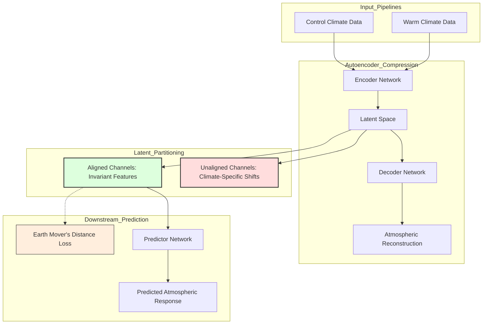

# CERA Framework Guide

This document describes the Climate-invariant Encoding through Representation Alignment (CERA) framework in OxidizeMath.

## Purpose

The CERA framework models physical atmospheric processes across different climate regimes. Standard machine learning models frequently overfit to statistical features (such as mean and variance) of their training data. When applied to shifted climate scenarios (for example, pre-industrial climate versus four-times carbon dioxide forcing), unaligned models produce unreliable predictions.

CERA solves this problem. It learns a partitioned latent representation that separates climate-invariant physical dynamics from background climate state changes.

## Architecture and Representation Alignment

The CERA architecture consists of two primary components:

1. **Autoencoder**: Compresses atmospheric vertical profiles into a structured latent space.
2. **Predictor**: Maps the climate-invariant latent features to target atmospheric responses (such as cloud properties or precipitation).



### Representation Alignment Pipeline

The training pipeline uses two simultaneous optimization objectives:

1. **Reconstruction Loss**: The autoencoder must reconstruct the complete atmospheric input from all latent channels. This constraint guarantees that the latent representation preserves all essential physical information.
2. **Distribution Alignment (EMD Loss)**: An Earth Mover's Distance (EMD) loss compares the distribution of the aligned channels between control climate samples and warm climate samples. This loss penalizes differences between climate distributions.
3. **Task Prediction Loss**: The predictor network reads only the aligned latent channels. Because the aligned channels cannot encode climate-specific distribution shifts, the predictor learns climate-invariant relationships.

## Configuration Parameters

The `CeraConfig` struct configures the model dimensions and training loss weights:

| Parameter | Type | Description |
| :--- | :--- | :--- |
| `in_channels` | `usize` | Number of physical variables per vertical level (such as temperature and humidity). |
| `latent_channels` | `usize` | Total dimension of the compressed latent space. |
| `aligned_channels` | `usize` | Number of latent channels constrained by representation alignment (`<= latent_channels`). |
| `num_levels` | `usize` | Number of atmospheric vertical pressure levels. |
| `output_size` | `usize` | Dimension of the downstream prediction target. |
| `lambda_pred` | `f32` | Weight for the downstream task prediction loss. |
| `lambda_emd` | `f32` | Weight for the Earth Mover's Distance representation alignment loss. |

## Code Example

The following code example shows how to configure and initialize the CERA model in Rust:

```rust
use domain_climate::climate::cera::Cera;
use domain_climate::climate::config::CeraConfig;
use nalgebra::DMatrix;

// 1. Define model configuration
let config = CeraConfig {
    in_channels: 2,
    latent_channels: 4,
    aligned_channels: 2,
    num_levels: 10,
    output_size: 5,
    epochs: 1,
    batch_size: 1,
    learning_rate: 0.01,
    lambda_pred: 1.0,
    lambda_emd: 0.1,
};

// 2. Initialize the CERA model
let model = Cera::new(config).expect("Valid CERA model configuration");

// 3. Prepare vertical atmospheric profile input matrix
let inputs = DMatrix::from_fn(10, 2, |r, c| (r + c) as f32 * 0.1);

// 4. Compute climate-invariant prediction
let predictions = model.predict(&inputs);
assert_eq!(predictions.nrows(), 1);
assert_eq!(predictions.ncols(), 5);
```

## Related References

- CERA implementation: [`crates/domain_climate/src/climate/cera.rs`](../../crates/domain_climate/src/climate/cera.rs)
- Climate module entry point: [`crates/domain_climate/src/climate/mod.rs`](../../crates/domain_climate/src/climate/mod.rs)
- Interactive CERA simulation tab: [`math_explorer_gui/src/tabs/climate/cera.rs`](../../math_explorer_gui/src/tabs/climate/cera.rs)
- [System Overview](system_overview.md)
