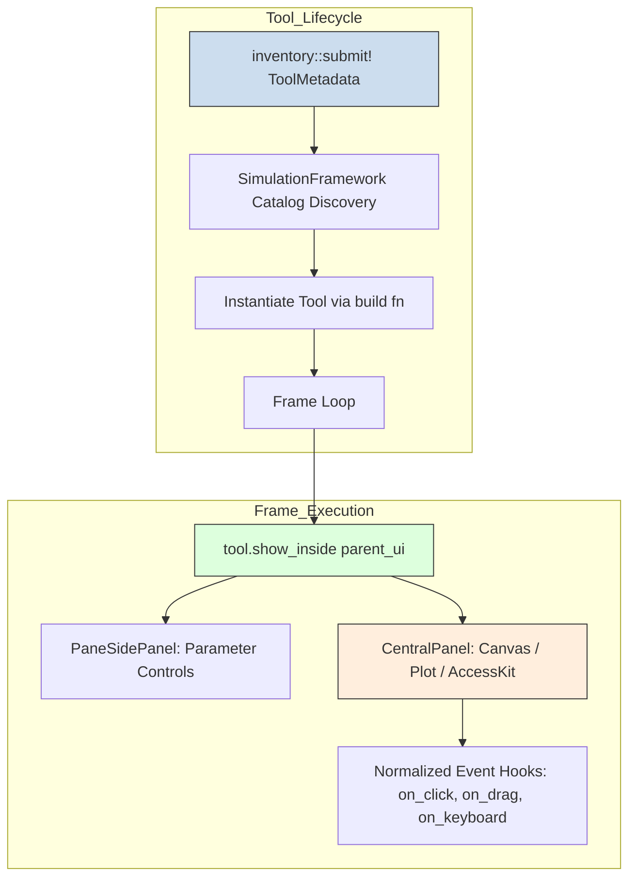

# Interactive Tool Onboarding Walkthrough

This document guides developers and researchers through creating a new interactive simulation tool inside a multi-domain tab in the `math_explorer_gui` application.

## Overview

The `math_explorer_gui` crate combines static `inventory` [`ExplorerTab`](../../apps/math_explorer_gui/src/tabs/mod.rs) registration (`TabDescriptor`) with a federated tool catalog backed by [`SimulationFramework`](../../apps/math_explorer_gui/src/framework/mod.rs). Each interactive simulation implements [`TheoryDescribable`](../../crates/00_foundation/scientific_metadata/src/theory.rs) and [`InteractiveTool`](../../apps/math_explorer_gui/src/framework/mod.rs), renders inside scoped multi-pane viewports via [`InteractiveTool::show_inside`](../../apps/math_explorer_gui/src/framework/mod.rs), and registers itself at startup using [`inventory::submit!`](../../apps/math_explorer_gui/src/framework/mod.rs).



## Step-by-Step Implementation Guide

Follow these four steps to implement and register a new simulation tool inside `math_explorer_gui/src/tabs/<domain>/<tool_name>.rs`.

### Step 1: Define the Simulation State and Validated Serialization

Define your runtime simulation struct with `Default`, bounded time-stepping helpers, and a `#[serde(deny_unknown_fields)]` configuration snapshot struct for JSON preset persistence:

```rust
use serde::{Deserialize, Serialize};

#[derive(Debug, Clone, PartialEq, Serialize, Deserialize)]
#[serde(deny_unknown_fields)]
pub struct HarmonicOscillatorState {
    pub mass: f32,
    pub spring_k: f32,
    pub damping: f32,
}

pub struct HarmonicOscillatorTool {
    pub mass: f32,
    pub spring_k: f32,
    pub damping: f32,
    pub position: f32,
    pub velocity: f32,
}

impl Default for HarmonicOscillatorTool {
    fn default() -> Self {
        Self {
            mass: 1.0,
            spring_k: 10.0,
            damping: 0.1,
            position: 1.0,
            velocity: 0.0,
        }
    }
}

impl HarmonicOscillatorTool {
    pub fn advance_step(&mut self, dt: f32) {
        assert!(self.mass > 0.0 && dt.is_finite());
        let acceleration =
            (-self.spring_k * self.position - self.damping * self.velocity) / self.mass;
        self.velocity += acceleration * dt;
        self.position += self.velocity * dt;
    }

    pub fn serialize_state_json(&self) -> Option<String> {
        serde_json::to_string(&HarmonicOscillatorState {
            mass: self.mass,
            spring_k: self.spring_k,
            damping: self.damping,
        })
        .ok()
    }

    pub fn restore_state_json(&mut self, state: &str) -> Result<(), String> {
        let loaded: HarmonicOscillatorState =
            serde_json::from_str(state).map_err(|e| format!("Invalid oscillator state: {e}"))?;
        if !loaded.mass.is_finite() || !(0.1..=10.0).contains(&loaded.mass) {
            return Err("mass must be finite in [0.1, 10.0]".to_string());
        }
        if !loaded.spring_k.is_finite() || !(0.1..=50.0).contains(&loaded.spring_k) {
            return Err("spring_k must be finite in [0.1, 50.0]".to_string());
        }
        if !loaded.damping.is_finite() || !(0.0..=2.0).contains(&loaded.damping) {
            return Err("damping must be finite in [0.0, 2.0]".to_string());
        }
        self.mass = loaded.mass;
        self.spring_k = loaded.spring_k;
        self.damping = loaded.damping;
        self.position = 1.0;
        self.velocity = 0.0;
        Ok(())
    }
}

let mut oscillator = HarmonicOscillatorTool::default();
oscillator.advance_step(0.05);
assert!(oscillator.position < 1.0);
let json = oscillator.serialize_state_json().expect("serializes");
oscillator.mass = 4.0;
oscillator.restore_state_json(&json).expect("restores valid state");
assert!((oscillator.mass - 1.0).abs() < f32::EPSILON);
assert!(oscillator.restore_state_json(r#"{"mass":1.0,"spring_k":10.0,"damping":0.1,"extra":1}"#).is_err());
```

### Step 2: Implement the `TheoryDescribable` Trait

Each tool exposes verified theoretical descriptions, accessible phonetic descriptions, literature citations, governing LaTeX formulas, and parameter bounds via [`TheoryDescribable`](../../crates/00_foundation/scientific_metadata/src/theory.rs). All methods return owned `String` and `HashMap` values (`theory_description`, `phonetic_description`, `theory_citation`, `available_descriptions`, `theory_parameters`, and `theory_latex_equation`):

```rust
use scientific_metadata::theory::{ParameterConstraint, TheoryDescribable};
use std::collections::HashMap;
# pub struct HarmonicOscillatorTool {
#     pub mass: f32,
#     pub spring_k: f32,
#     pub damping: f32,
# }
# impl Default for HarmonicOscillatorTool {
#     fn default() -> Self {
#         Self { mass: 1.0, spring_k: 10.0, damping: 0.1 }
#     }
# }

impl TheoryDescribable for HarmonicOscillatorTool {
    fn theory_description(&self) -> String {
        format!(
            "Second-order linear damped harmonic oscillator with mass m = {:.2} kg, spring stiffness k = {:.2} N/m, and viscous damping c = {:.2} N·s/m.",
            self.mass, self.spring_k, self.damping
        )
    }

    fn phonetic_description(&self) -> String {
        "Damped harmonic oscillator governed by Hooke's restoring force and linear viscous damping"
            .to_string()
    }

    fn theory_citation(&self) -> String {
        "Landau, L. D., & Lifshitz, E. M. (1976). Mechanics (3rd ed.). Butterworth-Heinemann."
            .to_string()
    }

    fn available_descriptions(&self) -> HashMap<String, String> {
        let mut map = HashMap::new();
        map.insert("mass".to_string(), "Inertial mass m (kg)".to_string());
        map.insert(
            "spring_k".to_string(),
            "Hookean spring stiffness k (N/m)".to_string(),
        );
        map.insert(
            "damping".to_string(),
            "Linear viscous damping coefficient c (N·s/m)".to_string(),
        );
        map
    }

    fn theory_parameters(&self) -> HashMap<String, ParameterConstraint> {
        let mut params = HashMap::new();
        params.insert(
            "mass".to_string(),
            ParameterConstraint {
                min: 0.1,
                max: 10.0,
                step: 0.1,
            },
        );
        params.insert(
            "spring_k".to_string(),
            ParameterConstraint {
                min: 0.1,
                max: 50.0,
                step: 0.5,
            },
        );
        params.insert(
            "damping".to_string(),
            ParameterConstraint {
                min: 0.0,
                max: 2.0,
                step: 0.05,
            },
        );
        params
    }

    fn theory_latex_equation(&self) -> Option<String> {
        Some(r"m \ddot{x}(t) + c \dot{x}(t) + k x(t) = 0".to_string())
    }
}

let tool = HarmonicOscillatorTool::default();
assert!(tool.theory_description().contains("1.00 kg"));
assert_eq!(tool.theory_parameters().len(), 3);
assert!(tool.theory_latex_equation().is_some());
```

### Step 3: Implement the `InteractiveTool` Trait (`show_inside`)

Because `math_explorer_gui` is a binary package (`src/main.rs`), import GUI framework types via crate-relative `crate::` paths (never `math_explorer_gui::`). `InteractiveTool::show` delegates to [`InteractiveTool::show_inside`](../../apps/math_explorer_gui/src/framework/mod.rs) so tools render cleanly inside single-pane and multi-pane split viewports. Use `PaneSidePanel::left(scoped_panel_id(parent_ui, ...)).show_inside(parent_ui, ...)` for controls and `egui::CentralPanel::default().show_inside(parent_ui, ...)` for the visualization canvas (or rely on the default `show_inside` helper by overriding `show_ui` and `draw`).

Note that the interactive frame loop invokes `show_inside()` every frame (never `step_simulation()`). Interactive controls advance state inside `show_inside()` (or background `async_sim` workers), whereas `step_simulation()` is an optional offscreen hook invoked **only** during multi-frame GIF animation export (`InteractiveTool::sample_animation_frames`), after which `SimulationFramework` restores the tool's saved state:

```rust,ignore
use crate::accessibility::{paint_canvas_focus_ring, register_canvas_accessibility};
use crate::framework::{InteractiveTool, PaneSidePanel, scoped_panel_id};
use eframe::egui;
use scientific_metadata::theory::TheoryDescribable;

impl InteractiveTool for HarmonicOscillatorTool {
    fn name(&self) -> &'static str {
        "Harmonic Oscillator"
    }

    fn domain(&self) -> &'static str {
        "physics"
    }

    fn theory(&self) -> &dyn TheoryDescribable {
        self
    }

    fn save_state(&self) -> Option<String> {
        self.serialize_state_json()
    }

    fn try_load_state(&mut self, state: &str) -> Result<(), String> {
        self.restore_state_json(state)
    }

    fn show_inside(&mut self, parent_ui: &mut egui::Ui) {
        let panel_id = scoped_panel_id(parent_ui, "harmonic_oscillator_controls");
        PaneSidePanel::left(panel_id).show_inside(parent_ui, |ui| {
            ui.heading("Oscillator Parameters");
            ui.add(egui::Slider::new(&mut self.mass, 0.1..=10.0).text("Mass (kg)"));
            ui.add(egui::Slider::new(&mut self.spring_k, 0.1..=50.0).text("Spring Constant k"));
            ui.add(egui::Slider::new(&mut self.damping, 0.0..=2.0).text("Damping c"));

            ui.horizontal(|ui| {
                if ui.button("Step").clicked() {
                    self.advance_step(0.05);
                }
                if ui.button("Reset Position").clicked() {
                    self.position = 1.0;
                    self.velocity = 0.0;
                }
            });
        });

        egui::CentralPanel::default().show_inside(parent_ui, |ui| {
            let (response, painter) =
                ui.allocate_painter(ui.available_size(), egui::Sense::focusable_noninteractive());
            let summary = format!("x = {:.2} m, v = {:.2} m/s", self.position, self.velocity);
            register_canvas_accessibility(
                ui,
                &response,
                egui::accesskit::Role::GraphicsDocument,
                "Damped Harmonic Oscillator Canvas",
                Some(&summary),
            );
            paint_canvas_focus_ring(ui, &response);

            let center = response.rect.center();
            let bob_pos = egui::Pos2::new(center.x + self.position * 100.0, center.y);
            painter.line_segment(
                [center, bob_pos],
                egui::Stroke::new(2.0_f32, egui::Color32::GRAY),
            );
            painter.circle_filled(bob_pos, 15.0, egui::Color32::from_rgb(50, 150, 250));
        });
    }

    /// Invoked exclusively during offscreen multi-frame GIF animation export (`sample_animation_frames`).
    fn step_simulation(&mut self) {
        self.advance_step(0.05);
    }
}
```

Implementing `domain()`, `save_state()`, and `try_load_state()` automatically enables JSON preset export (`export_preset_json`), validated JSON preset import (`import_preset_json`), URL state sharing, baseline parameter reset, and Starter Gallery template dispatch.

### Step 4: Register Tool Metadata and Expose the Domain Submodule

Submit your `ToolMetadata` and `StarterPresetMetadata` entries via `inventory::submit!` at the bottom of `math_explorer_gui/src/tabs/<domain>/<tool_name>.rs`. Ensure `STARTER_PRESET_JSON` wraps a `"config"` object matching your `#[serde(deny_unknown_fields)]` state struct and a `"metadata.domain"` matching `domain()`:

```rust,ignore
const STARTER_PRESET_JSON: &str = r#"{
  "metadata": {
    "schema_version": "1.0",
    "title": "Underdamped Harmonic Oscillator",
    "domain": "physics",
    "timestamp": "2026-11-18T00:00:00Z"
  },
  "config": {
    "mass": 1.0,
    "spring_k": 10.0,
    "damping": 0.1
  }
}"#;

inventory::submit! {
    crate::framework::ToolMetadata {
        id: "HarmonicOscillatorTool",
        display_name: "Harmonic Oscillator",
        domain: "physics",
        tags: &["mechanics", "differential_equations", "oscillator"],
        build: || Box::new(HarmonicOscillatorTool::default()),
    }
}

inventory::submit! {
    crate::starter_gallery::StarterPresetMetadata {
        id: "harmonic_oscillator_starter",
        title: "Underdamped Harmonic Oscillator",
        description: "m·x'' + c·x' + k·x = 0: Damped Hookean spring-mass oscillation.",
        category: "Classical Mechanics",
        icon: "🌀",
        domain: "physics",
        tool_name: Some("HarmonicOscillatorTool"),
        preset_generator: || STARTER_PRESET_JSON,
    }
}
```

Finally, expose your submodule (`pub mod <tool_name>;`) inside its enclosing domain tab's `math_explorer_gui/src/tabs/<domain>/mod.rs` so the module compiles and registers with `inventory` (only new top-level `ExplorerTab` domains declare `pub mod <domain>;` in `math_explorer_gui/src/tabs/mod.rs` and submit a `TabDescriptor` via `inventory::submit!`).

## Event Handling Hooks

When a tool uses the default `InteractiveTool::show_inside` pipeline (`show_ui` + `draw`), the framework provides normalized canvas interaction hooks:

| Method Hook | Invocation Condition | Usage Example |
| :--- | :--- | :--- |
| `on_hover(&mut self, ctx)` | Mouse pointer hovers over canvas | Display coordinate tooltips or inspection values |
| `on_drag(&mut self, ctx)` | User clicks and drags inside canvas | Pan camera view or drag simulation elements |
| `on_click(&mut self, ctx)` | Mouse button clicks inside canvas | Select particles or place obstacles |
| `on_brush(&mut self, ctx)` | Continuous stroke dragging across canvas | Paint velocity fields or density distributions |
| `on_keyboard(&mut self, ctx)` | Canvas has keyboard focus and key is pressed | Move player or adjust simulation time scale |
| `on_gesture(&mut self, ctx)` | Touchscreen multi-touch gesture active | Pinch-to-zoom and canvas rotation |

### Registering Tool Shortcuts for Discovery

Tools that define custom keyboard shortcuts must advertise their `CommandMetadata` every frame outside focus guards so hotkeys appear in the **Keyboard Shortcuts** modal (`?` or `Ctrl+/` / `Cmd+/`). Call `egui_plot::commands::CommandRegistryData::register` inside `show_inside` or `show_ui` to record metadata without consuming input events. Do **not** intercept global history or session shortcuts (`Ctrl+Z` / `Cmd+Z`, `Ctrl+Y`, `Ctrl+Shift+Z` / `Cmd+Shift+Z`, `Ctrl+O`, `Ctrl+S`) inside tool handlers — `WorkspaceSessionManager` owns workspace-wide undo, redo, and file persistence before panes run:

```rust,ignore
use egui_plot::commands::{CommandRegistryData, CommandTrigger};

// Inside InteractiveTool::show_inside(ui) or show_ui(ui): advertise custom shortcuts
CommandRegistryData::register(
    ui.ctx(),
    "Add Node",
    "Insert a new node at the viewport center",
    CommandTrigger::Key(egui::Key::N),
    false,
    "My Tool",
);
```

### Custom `show_inside` Overrides, Focusable Canvases, and `AccessKit`

The default `InteractiveTool::show_inside` implementation allocates its central canvas with `egui::Sense::click_and_drag()` (which includes `egui::Sense::FOCUSABLE`) and dispatches `on_keyboard` when focused. When a tool overrides `InteractiveTool::show_inside` directly, it must preserve keyboard reachability (`WCAG 2.2 SC 2.1.1`, `SC 2.1.2`, `SC 2.4.3`) and `AccessKit` semantics:

1. **Custom Painter Regions**: Allocate custom canvases with `egui::Sense::focusable_noninteractive()` (for read-only visualizations) or `egui::Sense::click()` / `egui::Sense::click_and_drag()` (for interactive canvases) instead of `egui::Sense::hover()`. Attach an `AccessKit` role, non-empty label, and summary value via `crate::accessibility::register_canvas_accessibility`, and paint a focus ring via `crate::accessibility::paint_canvas_focus_ring`:

```rust,ignore
let (response, painter) =
    ui.allocate_painter(ui.available_size(), egui::Sense::focusable_noninteractive());
crate::accessibility::register_canvas_accessibility(
    ui,
    &response,
    egui::accesskit::Role::GraphicsDocument,
    "Network Metrics Visualization",
    Some("16 nodes, 24 edges"),
);
crate::accessibility::paint_canvas_focus_ring(ui, &response);
```

2. **Raster Texture Views**: Render textures with `egui::Image::new(texture).alt_text(...).sense(...)` rather than raw `ui.image(texture)` calls so `AccessKit` emits `Role::Image` with non-empty alternative text and `Tab` traversal can focus the image:

```rust,ignore
let response = ui.add(
    egui::Image::new(texture)
        .alt_text("Ulam Prime Spiral visualization (100x100 grid)")
        .sense(egui::Sense::focusable_noninteractive()),
);
crate::accessibility::paint_canvas_focus_ring(ui, &response);
```

3. **Arrow-Key Cursors Without `Tab` Traps**: When an interactive canvas uses arrow keys to move an internal cell or node cursor, call `Memory::set_focus_lock_filter` (or `crate::accessibility::lock_canvas_arrow_keys`) **only while `response.has_focus()`** with `tab: false` and `escape: false` so `Tab` and `Shift+Tab` always move focus cleanly out of the canvas:

```rust,ignore
if response.has_focus() {
    ui.memory_mut(|m| {
        m.set_focus_lock_filter(
            response.id,
            egui::EventFilter {
                tab: false,
                horizontal_arrows: true,
                vertical_arrows: true,
                escape: false,
            },
        );
    });
}
```

## Dual-Backend Sonification Integration

Interactive tools can map live mathematical invariants to real-time audio and `.wav` exports through [`math_explorer_gui/src/audio/`](../../apps/math_explorer_gui/src/audio/mod.rs):

- **Stack-Allocated `SonificationFrame`**: Compute a `Copy`, zero-allocation [`SonificationFrame`](../../apps/math_explorer_gui/src/audio/frame.rs) (up to 8 polyphonic voices, `20.0..=8000.0 Hz` frequency clamp, stereo pan, FM modulation, and Fourier `PeriodicWave` harmonic weights derived via `calculate_fourier_coefficients_real`). Asynchronous `SimRunner` implementations attach `Some(frame)` to `StateSnapshot::sonification`, and [`UnifiedSimTool`](../../apps/math_explorer_gui/src/async_sim/unified/tool.rs) renders the sonification controls automatically.
- **Synchronous Tool Integration**: Immediate-mode tools pass their current [`SonificationFrame`](../../apps/math_explorer_gui/src/audio/frame.rs) to [`crate::audio::render_sonification_panel`](../../apps/math_explorer_gui/src/audio/ui.rs), which renders the user-gesture **Enable Audio** / **Mute Audio** toggle, `.wav` export button, timbre selector, and WCAG AA `Role::Meter` visual `dBFS` + `Hz` readout.
- **Lifecycle and Autoplay Safety**: [`WebAudioNodeBackend`](../../apps/math_explorer_gui/src/audio/web_audio.rs) (`wasm32`) never constructs or resumes an `AudioContext` until an explicit user click or keypress, enforces a `-3.0 dBFS` limiter ceiling with `15 ms` `AudioParam::set_target_at_time` smoothing, and ramps to silence within `<= 30 ms` on pause, solver divergence, WebGL context loss, or window blur. [`OfflinePcmSynthesizer`](../../apps/math_explorer_gui/src/audio/synth.rs) mirrors the same `SonificationBackend` contract for deterministic `rustfft` tests and RIFF `.wav` export.

## Shared Simulation Topology & Point-Cloud Bus

Multi-pane tools that operate on graphs or 3D landmark point clouds can subscribe to the workspace-scoped [`SharedSimulationBus`](../../apps/math_explorer_gui/src/app/sim_bus.rs) without modifying the `InteractiveTool` or `ExplorerTab` trait signatures:

- **Workspace Isolation via `egui::Context`**: `MathExplorerApp` owns an `Arc`-backed `SharedSimulationBus` and installs it into `egui::Context` every frame alongside `ComparisonSyncConfig::link_topology` (`View -> Multi-Pane Sync -> Link Topology`). Never store cross-tool payloads in process-global `OnceLock` or `Mutex` statics.
- **Copy-on-Write CSR Graph Ingestion (`SharedGraphTopology`)**: Add a `TopologySource` field (`SharedBus` default, `LocalPreset` per-pane opt-out) annotated with `#[serde(default, skip_serializing_if = "TopologySource::is_default")]` on your `#[serde(deny_unknown_fields)]` state struct so `.mws`, `.json`, and `#tab=...&state=...` URL links remain compact inside `URL_JSON_BOUNDS` (`4 KiB`) without duplicating full vertex/edge buffers.
- **Accessible Control Bar & Clamping Badges**: Call [`crate::app::render_topology_source_bar`](../../apps/math_explorer_gui/src/app/sim_bus.rs) in your side panel and poll `SharedSimulationBus::active_graph_for(ctx, self.topology_source)` at the top of `show_inside`. When a solver enforces a domain cap stricter than the bus ceiling (`256` nodes, `2,048` edges)—such as `NeuralNetworkVizTool` clamping coupled Hodgkin-Huxley circuits to `32` neurons—pass `Some("Clamped N -> 32 neurons")` so the status bar renders a WCAG 2.2 AA contrast pill and polite `TwinSlotLiveRegion` announcements.
- **3D Point-Cloud Streaming (`SharedPointCloud3D`)**: Producers such as `AttractorRunner` publish `Arc<SharedPointCloud3D>` frames (`<= 128` landmarks) onto their workspace `SharedSimulationBus`, and consumers such as `VietorisRipsTool` poll newer revisions via `latest_point_cloud_3d_since`.

## Related References

- Interactive tool trait definition: [`math_explorer_gui/src/framework/mod.rs`](../../apps/math_explorer_gui/src/framework/mod.rs)
- Shared simulation topology & point-cloud bus: [`math_explorer_gui/src/app/sim_bus.rs`](../../apps/math_explorer_gui/src/app/sim_bus.rs) and [ADR 20261123: SharedSimulationBus and Zero-Allocation CSR Kernels](../adr/20261123-shared-simulation-topology-bus.md)
- Static inventory tab registration: [`math_explorer_gui/src/tabs/mod.rs`](../../apps/math_explorer_gui/src/tabs/mod.rs) and [ADR 20261123: Static Inventory Tab Registration and Scoped Build Scripts](../adr/20261123-inventory-tabs-and-scoped-build-scripts.md)
- Spatial brush kit & field sculpting: [`math_explorer_gui/src/framework/spatial_brush.rs`](../../apps/math_explorer_gui/src/framework/spatial_brush.rs) and [ADR 0045: SpatialBrushKit and Multi-Domain Field Sculpting](../adr/0045-spatial-brush-kit-and-field-sculpting.md)
- Raster brush canvas & RLE spatial masks: [`math_explorer_gui/src/framework/raster_brush/mod.rs`](../../apps/math_explorer_gui/src/framework/raster_brush/mod.rs) and [ADR 20261123: Shared `RasterBrushCanvas`, Pre-Allocation RLE `base64url` Spatial Masks, and Live 2D Field Sculpting](../adr/20261123-raster-brush-canvas-and-spatial-masks.md)
- Dual-backend sonification architecture: [ADR 0040](../adr/0040-dual-backend-web-audio-sonification.md)
- Example tool implementation (CERA): [`math_explorer_gui/src/tabs/climate/cera.rs`](../../apps/math_explorer_gui/src/tabs/climate/cera.rs)
- Example tool implementation (Radiation Dose): [`math_explorer_gui/src/tabs/medical/dose/mod.rs`](../../apps/math_explorer_gui/src/tabs/medical/dose/mod.rs)
- [System Overview](system_overview.md)
- [Contributing Guide](../../CONTRIBUTING.md)
