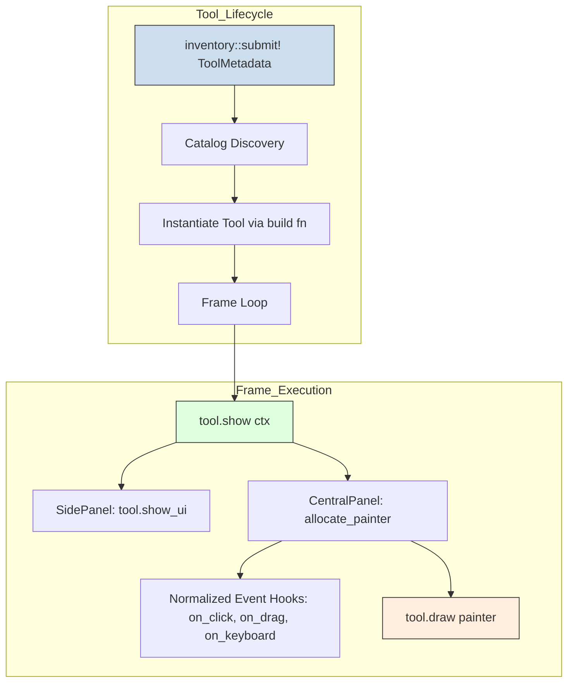

# Interactive Tool Onboarding Walkthrough

This document guides developers and researchers through creating a new interactive simulation tab in the `math_explorer_gui` application.

## Overview

The `math_explorer_gui` crate uses an extensible plugin architecture. Each interactive tab implements the [`InteractiveTool`](../../math_explorer_gui/src/framework/mod.rs) trait and registers itself with the global inventory using [`inventory::submit!`](../../math_explorer_gui/src/framework/mod.rs).

The GUI runtime discovers registered tools automatically at startup and displays them in the navigation sidebar.



## Step-by-Step Implementation Guide

Follow these four steps to implement and register a new simulation tool.

### Step 1: Define the Simulation State

Create a new file in `math_explorer_gui/src/tabs/<domain>/<tool_name>.rs`. Define your model state struct with `Default`:

```rust,ignore
use eframe::egui;
use math_explorer_gui::framework::InteractiveTool;
use scientific_metadata::theory::TheoryDescribable;

pub struct HarmonicOscillatorTool {
    mass: f32,
    spring_k: f32,
    damping: f32,
    position: f32,
    velocity: f32,
}

impl Default for HarmonicOscillatorTool {
    fn default() -> Self {
        Self {
            mass: 1.0,
            spring_k: 10.0,
            damping: 0.1,
            position: 1.0,
            velocity: 0.0,
        }
    }
}
```

### Step 2: Implement the `TheoryDescribable` Trait

Each tool must link to theoretical documentation. Implement `TheoryDescribable` on your tool struct:

```rust,ignore
impl TheoryDescribable for HarmonicOscillatorTool {
    fn theory_title(&self) -> &'static str {
        "Damped Harmonic Oscillator"
    }

    fn theory_description(&self) -> &'static str {
        "Models standard second-order linear differential equation with damping and Hooke's restoring force."
    }

    fn theory_equations(&self) -> &'static [&'static str] {
        &["m * x''(t) + c * x'(t) + k * x(t) = 0"]
    }
}
```

### Step 3: Implement the `InteractiveTool` Trait

Implement `InteractiveTool`. Provide `name()`, `domain()`, `theory()`, validated state serialization (`save_state()` and `try_load_state()` using `#[serde(deny_unknown_fields)]`), parameter controls in `show_ui()`, and canvas rendering in `draw()`:

```rust,ignore
#[derive(serde::Serialize, serde::Deserialize)]
#[serde(deny_unknown_fields)]
struct HarmonicOscillatorState {
    mass: f32,
    spring_k: f32,
    damping: f32,
}

impl InteractiveTool for HarmonicOscillatorTool {
    fn name(&self) -> &'static str {
        "Harmonic Oscillator"
    }

    fn domain(&self) -> &'static str {
        "physics"
    }

    fn theory(&self) -> &dyn TheoryDescribable {
        self
    }

    fn save_state(&self) -> Option<String> {
        serde_json::to_string(&HarmonicOscillatorState {
            mass: self.mass,
            spring_k: self.spring_k,
            damping: self.damping,
        })
        .ok()
    }

    fn try_load_state(&mut self, state: &str) -> Result<(), String> {
        let loaded: HarmonicOscillatorState =
            serde_json::from_str(state).map_err(|e| format!("Invalid oscillator state: {e}"))?;
        if !loaded.mass.is_finite() || !(0.1..=10.0).contains(&loaded.mass) {
            return Err("mass must be finite in [0.1, 10.0]".to_string());
        }
        if !loaded.spring_k.is_finite() || !(0.1..=50.0).contains(&loaded.spring_k) {
            return Err("spring_k must be finite in [0.1, 50.0]".to_string());
        }
        if !loaded.damping.is_finite() || !(0.0..=2.0).contains(&loaded.damping) {
            return Err("damping must be finite in [0.0, 2.0]".to_string());
        }
        self.mass = loaded.mass;
        self.spring_k = loaded.spring_k;
        self.damping = loaded.damping;
        self.position = 1.0;
        self.velocity = 0.0;
        Ok(())
    }

    fn show_ui(&mut self, ui: &mut egui::Ui) {
        ui.label("Oscillator Parameters:");
        ui.add(egui::Slider::new(&mut self.mass, 0.1..=10.0).text("Mass (kg)"));
        ui.add(egui::Slider::new(&mut self.spring_k, 0.1..=50.0).text("Spring Constant k"));
        ui.add(egui::Slider::new(&mut self.damping, 0.0..=2.0).text("Damping c"));

        if ui.button("Reset Position").clicked() {
            self.position = 1.0;
            self.velocity = 0.0;
        }
    }

    fn draw(&mut self, _ui: &mut egui::Ui, response: &egui::Response, painter: &egui::Painter) {
        let center = response.rect.center();
        let scale = 100.0;
        let bob_pos = egui::Pos2::new(center.x + self.position * scale, center.y);

        // Draw spring anchor and mass bob
        painter.line_segment([center, bob_pos], egui::Stroke::new(2.0, egui::Color32::GRAY));
        painter.circle_filled(bob_pos, 15.0, egui::Color32::from_rgb(50, 150, 250));
    }

    fn step_simulation(&mut self) {
        let dt = 0.016;
        let acceleration = (-self.spring_k * self.position - self.damping * self.velocity) / self.mass;
        self.velocity += acceleration * dt;
        self.position += self.velocity * dt;
    }
}
```

Implementing `domain()`, `save_state()`, and `try_load_state()` automatically enables JSON preset export (`export_preset_json`), validated JSON preset import (`import_preset_json`), baseline parameter reset, and Starter Gallery template dispatch.

### Step 4: Register Tool and Starter Preset Metadata

Submit your `ToolMetadata` and `StarterPresetMetadata` entries with `inventory::submit!` at the bottom of the file. Ensure `STARTER_PRESET_JSON` wraps a `"config"` object matching your `#[serde(deny_unknown_fields)]` state struct and a `"metadata.domain"` matching `domain()`:

```rust,ignore
const STARTER_PRESET_JSON: &str = r#"{
  "metadata": {
    "schema_version": "1.0",
    "title": "Underdamped Harmonic Oscillator",
    "domain": "physics",
    "timestamp": "2026-11-18T00:00:00Z"
  },
  "config": {
    "mass": 1.0,
    "spring_k": 10.0,
    "damping": 0.1
  }
}"#;

inventory::submit! {
    math_explorer_gui::framework::ToolMetadata {
        id: "HarmonicOscillatorTool",
        display_name: "Harmonic Oscillator",
        domain: "physics",
        tags: &["mechanics", "differential_equations", "oscillator"],
        build: || Box::new(HarmonicOscillatorTool::default()),
    }
}

inventory::submit! {
    math_explorer_gui::starter_gallery::StarterPresetMetadata {
        id: "harmonic_oscillator_starter",
        title: "Underdamped Harmonic Oscillator",
        description: "m·x'' + c·x' + k·x = 0: Damped Hookean spring-mass oscillation.",
        category: "Classical Mechanics",
        icon: "🌀",
        domain: "physics",
        tool_name: Some("HarmonicOscillatorTool"),
        preset_generator: || STARTER_PRESET_JSON,
    }
}
```

Then register the module inside `math_explorer_gui/src/tabs/mod.rs` (or your domain module).

## Event Handling Hooks

The `InteractiveTool` trait provides default implementations for normalized interaction hooks. Override these methods as needed:

| Method Hook | Invocation Condition | Usage Example |
| :--- | :--- | :--- |
| `on_hover(&mut self, ctx)` | Mouse pointer hovers over canvas | Display coordinate tooltips or inspection values |
| `on_drag(&mut self, ctx)` | User clicks and drags inside canvas | Pan camera view or drag simulation elements |
| `on_click(&mut self, ctx)` | Mouse button clicks inside canvas | Select particles or place obstacles |
| `on_brush(&mut self, ctx)` | Continuous stroke dragging across canvas | Paint velocity fields or density distributions |
| `on_keyboard(&mut self, ctx)` | Canvas has keyboard focus and key is pressed | Move player or adjust simulation time scale |
| `on_gesture(&mut self, ctx)` | Touchscreen multi-touch gesture active | Pinch-to-zoom and canvas rotation |

### Registering Tool Shortcuts for Discovery

Because `on_keyboard` only executes when the simulation canvas holds focus, tools that define custom keyboard shortcuts must advertise their `CommandMetadata` every frame outside focus guards so hotkeys appear in the **Keyboard Shortcuts** modal (`?` or `Ctrl+/` / `Cmd+/`). Call `egui_plot::commands::CommandRegistryData::register` inside `show_ui` or `show` to record metadata without consuming input events. Do **not** intercept global history or session shortcuts (`Ctrl+Z` / `Cmd+Z`, `Ctrl+Y`, `Ctrl+Shift+Z` / `Cmd+Shift+Z`, `Ctrl+O`, `Ctrl+S`) inside tool handlers — `WorkspaceSessionManager` owns workspace-wide undo, redo, and file persistence before panes run:

```rust,ignore
use egui_plot::commands::{CommandRegistryData, CommandTrigger};

// Inside InteractiveTool::show_ui(ui): advertise custom tool shortcuts (never consume Ctrl+Z / Ctrl+Y)
CommandRegistryData::register(
    ui.ctx(),
    "Add Node",
    "Insert a new node at the viewport center",
    CommandTrigger::Key(egui::Key::N),
    false,
    "My Tool",
);
```

### Custom `show` Overrides, Focusable Canvases, and `AccessKit`

The default `InteractiveTool::show` implementation allocates its central canvas with `egui::Sense::click_and_drag()` (which includes `egui::Sense::FOCUSABLE`) and dispatches `on_keyboard` when focused. When a tool overrides `InteractiveTool::show` directly, it must preserve keyboard reachability (`WCAG 2.2 SC 2.1.1`, `SC 2.1.2`, `SC 2.4.3`) and `AccessKit` semantics:

1. **Custom Painter Regions**: Allocate custom canvases with `egui::Sense::focusable_noninteractive()` (for read-only visualizations) or `egui::Sense::click()` / `egui::Sense::click_and_drag()` (for interactive canvases) instead of `egui::Sense::hover()`. Attach an `AccessKit` role, non-empty label, and summary value via `crate::accessibility::register_canvas_accessibility` (built on `ctx.accesskit_node_builder`), and paint a focus ring via `crate::accessibility::paint_canvas_focus_ring`:

```rust,ignore
let (response, painter) =
    ui.allocate_painter(ui.available_size(), egui::Sense::focusable_noninteractive());
crate::accessibility::register_canvas_accessibility(
    ui,
    &response,
    egui::accesskit::Role::GraphicsDocument,
    "Network Metrics Visualization",
    Some("16 nodes, 24 edges"),
);
crate::accessibility::paint_canvas_focus_ring(ui, &response);
```

2. **Raster Texture Views**: Render textures with `egui::Image::new(texture).alt_text(...).sense(...)` rather than raw `ui.image(texture)` calls so `AccessKit` emits `Role::Image` with non-empty alternative text and `Tab` traversal can focus the image:

```rust,ignore
let response = ui.add(
    egui::Image::new(texture)
        .alt_text("Ulam Prime Spiral visualization (100x100 grid)")
        .sense(egui::Sense::focusable_noninteractive()),
);
crate::accessibility::paint_canvas_focus_ring(ui, &response);
```

3. **Arrow-Key Cursors Without `Tab` Traps**: When an interactive canvas uses arrow keys to move an internal cell or node cursor, call `Memory::set_focus_lock_filter` (or `crate::accessibility::lock_canvas_arrow_keys`) **only while `response.has_focus()`** with `tab: false` and `escape: false` so `Tab` and `Shift+Tab` always move focus cleanly out of the canvas:

```rust,ignore
if response.has_focus() {
    ui.memory_mut(|m| {
        m.set_focus_lock_filter(
            response.id,
            egui::EventFilter {
                tab: false,
                horizontal_arrows: true,
                vertical_arrows: true,
                escape: false,
            },
        );
    });
}
```

## Dual-Backend Sonification Integration

Interactive tools can map live mathematical invariants to real-time audio and `.wav` exports through [`math_explorer_gui/src/audio/`](../../math_explorer_gui/src/audio/mod.rs):

- **Stack-Allocated `SonificationFrame`**: Compute a `Copy`, zero-allocation [`SonificationFrame`](../../math_explorer_gui/src/audio/frame.rs) (up to 8 polyphonic voices, `20.0..=8000.0 Hz` frequency clamp, stereo pan, FM modulation, and Fourier `PeriodicWave` harmonic weights derived via `calculate_fourier_coefficients_real`). Asynchronous `SimRunner` implementations attach `Some(frame)` to `StateSnapshot::sonification`, and [`UnifiedSimTool`](../../math_explorer_gui/src/async_sim/unified/tool.rs) renders the sonification controls automatically.
- **Synchronous Tool Integration**: Immediate-mode tools pass their current [`SonificationFrame`](../../math_explorer_gui/src/audio/frame.rs) to [`crate::audio::render_sonification_panel`](../../math_explorer_gui/src/audio/ui.rs), which renders the user-gesture **Enable Audio** / **Mute Audio** toggle, `.wav` export button, timbre selector, and WCAG AA `Role::Meter` visual `dBFS` + `Hz` readout.
- **Lifecycle and Autoplay Safety**: [`WebAudioNodeBackend`](../../math_explorer_gui/src/audio/web_audio.rs) (`wasm32`) never constructs or resumes an `AudioContext` until an explicit user click or keypress, enforces a `-3.0 dBFS` limiter ceiling with `15 ms` `AudioParam::set_target_at_time` smoothing, and ramps to silence within `<= 30 ms` on pause, solver divergence, WebGL context loss, or window blur. [`OfflinePcmSynthesizer`](../../math_explorer_gui/src/audio/synth.rs) mirrors the same `SonificationBackend` contract for deterministic `rustfft` tests and RIFF `.wav` export.

## Related References

- Interactive tool trait definition: [`math_explorer_gui/src/framework/mod.rs`](../../math_explorer_gui/src/framework/mod.rs)
- Dual-backend sonification architecture: [ADR 0040](../adr/0040-dual-backend-web-audio-sonification.md)
- Example tool implementation (CERA): [`math_explorer_gui/src/tabs/climate/cera.rs`](../../math_explorer_gui/src/tabs/climate/cera.rs)
- Example tool implementation (Radiation Dose): [`math_explorer_gui/src/tabs/medical/dose.rs`](../../math_explorer_gui/src/tabs/medical/dose.rs)
- [System Overview](system_overview.md)
- [Contributing Guide](../../CONTRIBUTING.md)
