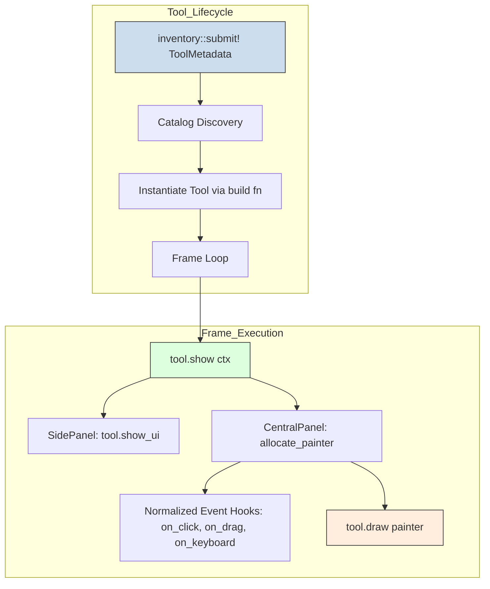

# Interactive Tool Onboarding Walkthrough

This document guides developers and researchers through creating a new interactive simulation tab in the `math_explorer_gui` application.

## Overview

The `math_explorer_gui` crate uses an extensible plugin architecture. Each interactive tab implements the [`InteractiveTool`](../../math_explorer_gui/src/framework/mod.rs) trait and registers itself with the global inventory using [`inventory::submit!`](../../math_explorer_gui/src/framework/mod.rs).

The GUI runtime discovers registered tools automatically at startup and displays them in the navigation sidebar.



## Step-by-Step Implementation Guide

Follow these four steps to implement and register a new simulation tool.

### Step 1: Define the Simulation State

Create a new file in `math_explorer_gui/src/tabs/<domain>/<tool_name>.rs`. Define your model state struct with `Default`:

```rust,ignore
use eframe::egui;
use math_explorer_gui::framework::InteractiveTool;
use scientific_metadata::theory::TheoryDescribable;

pub struct HarmonicOscillatorTool {
    mass: f32,
    spring_k: f32,
    damping: f32,
    position: f32,
    velocity: f32,
}

impl Default for HarmonicOscillatorTool {
    fn default() -> Self {
        Self {
            mass: 1.0,
            spring_k: 10.0,
            damping: 0.1,
            position: 1.0,
            velocity: 0.0,
        }
    }
}
```

### Step 2: Implement the `TheoryDescribable` Trait

Each tool must link to theoretical documentation. Implement `TheoryDescribable` on your tool struct:

```rust,ignore
impl TheoryDescribable for HarmonicOscillatorTool {
    fn theory_title(&self) -> &'static str {
        "Damped Harmonic Oscillator"
    }

    fn theory_description(&self) -> &'static str {
        "Models standard second-order linear differential equation with damping and Hooke's restoring force."
    }

    fn theory_equations(&self) -> &'static [&'static str] {
        &["m * x''(t) + c * x'(t) + k * x(t) = 0"]
    }
}
```

### Step 3: Implement the `InteractiveTool` Trait

Implement `InteractiveTool`. Provide `name()`, `theory()`, parameter controls in `show_ui()`, and canvas rendering in `draw()`:

```rust,ignore
impl InteractiveTool for HarmonicOscillatorTool {
    fn name(&self) -> &'static str {
        "Harmonic Oscillator"
    }

    fn theory(&self) -> &dyn TheoryDescribable {
        self
    }

    fn show_ui(&mut self, ui: &mut egui::Ui) {
        ui.label("Oscillator Parameters:");
        ui.add(egui::Slider::new(&mut self.mass, 0.1..=10.0).text("Mass (kg)"));
        ui.add(egui::Slider::new(&mut self.spring_k, 0.1..=50.0).text("Spring Constant k"));
        ui.add(egui::Slider::new(&mut self.damping, 0.0..=2.0).text("Damping c"));

        if ui.button("Reset Position").clicked() {
            self.position = 1.0;
            self.velocity = 0.0;
        }
    }

    fn draw(&mut self, _ui: &mut egui::Ui, response: &egui::Response, painter: &egui::Painter) {
        let center = response.rect.center();
        let scale = 100.0;
        let bob_pos = egui::Pos2::new(center.x + self.position * scale, center.y);

        // Draw spring anchor and mass bob
        painter.line_segment([center, bob_pos], egui::Stroke::new(2.0, egui::Color32::GRAY));
        painter.circle_filled(bob_pos, 15.0, egui::Color32::from_rgb(50, 150, 250));
    }

    fn step_simulation(&mut self) {
        let dt = 0.016;
        let acceleration = (-self.spring_k * self.position - self.damping * self.velocity) / self.mass;
        self.velocity += acceleration * dt;
        self.position += self.velocity * dt;
    }
}
```

### Step 4: Register with Tool Metadata

Submit your tool metadata with the `inventory::submit!` macro at the bottom of the file:

```rust,ignore
inventory::submit! {
    math_explorer_gui::framework::ToolMetadata {
        name: "Harmonic Oscillator",
        domain: "physics",
        tags: &["mechanics", "differential_equations", "oscillator"],
        build: || Box::new(HarmonicOscillatorTool::default()),
    }
}
```

Then register the module inside `math_explorer_gui/src/tabs/mod.rs` (or your domain module).

## Event Handling Hooks

The `InteractiveTool` trait provides default implementations for normalized interaction hooks. Override these methods as needed:

| Method Hook | Invocation Condition | Usage Example |
| :--- | :--- | :--- |
| `on_hover(&mut self, ctx)` | Mouse pointer hovers over canvas | Display coordinate tooltips or inspection values |
| `on_drag(&mut self, ctx)` | User clicks and drags inside canvas | Pan camera view or drag simulation elements |
| `on_click(&mut self, ctx)` | Mouse button clicks inside canvas | Select particles or place obstacles |
| `on_brush(&mut self, ctx)` | Continuous stroke dragging across canvas | Paint velocity fields or density distributions |
| `on_keyboard(&mut self, ctx)` | Canvas has keyboard focus and key is pressed | Move player or adjust simulation time scale |
| `on_gesture(&mut self, ctx)` | Touchscreen multi-touch gesture active | Pinch-to-zoom and canvas rotation |

## Related References

- Interactive tool trait definition: [`math_explorer_gui/src/framework/mod.rs`](../../math_explorer_gui/src/framework/mod.rs)
- Example tool implementation (CERA): [`math_explorer_gui/src/tabs/climate/cera.rs`](../../math_explorer_gui/src/tabs/climate/cera.rs)
- Example tool implementation (Radiation Dose): [`math_explorer_gui/src/tabs/medical/dose.rs`](../../math_explorer_gui/src/tabs/medical/dose.rs)
- [System Overview](system_overview.md)
- [Contributing Guide](../../CONTRIBUTING.md)
