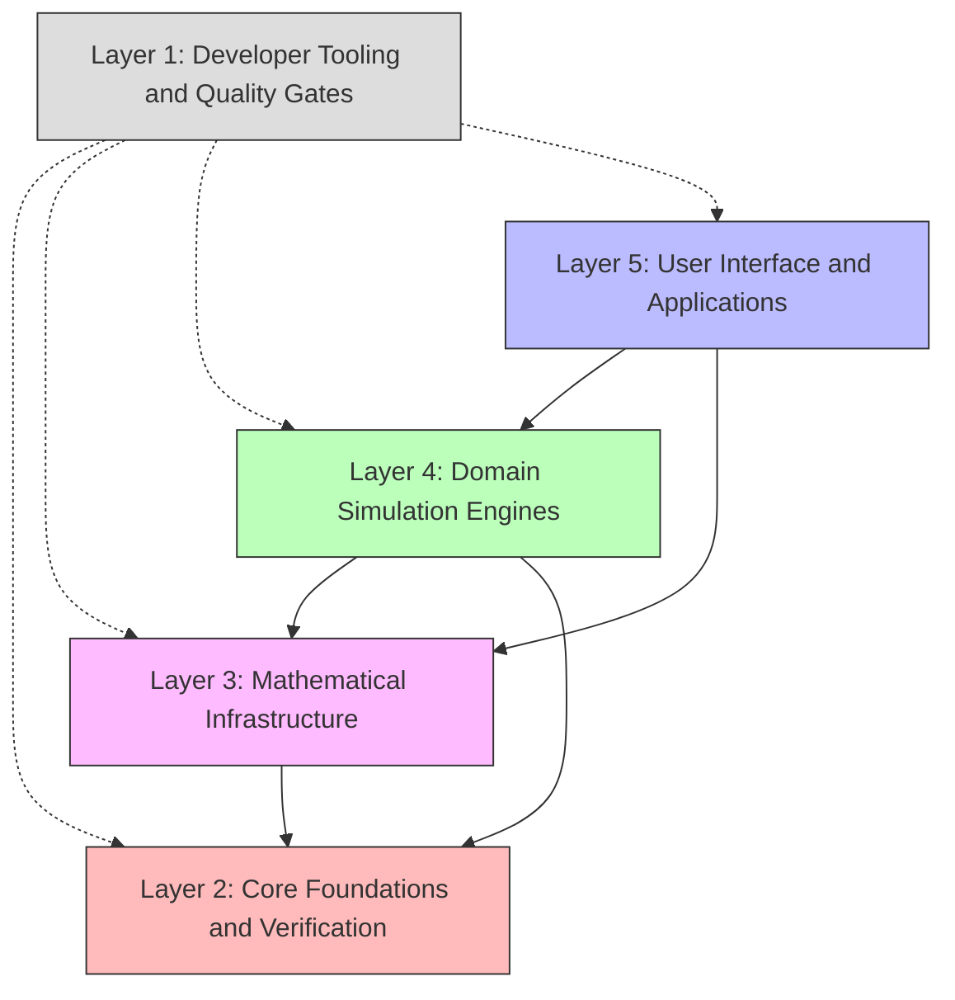

# System Overview and Crate Topology

This document describes the high-level system architecture and crate topology of OxidizeMath.

## System Architecture

OxidizeMath organizes scientific computation and interactive visualization into five clear architectural layers:

### Architectural Layers

1. **Developer Tooling (Layer 1)**: Tools execute pre-commit checks, verify code traceability, and test documentation examples.
2. **Core Foundations and Verification (Layer 2)**: Crates provide memory allocators, runtime verification, and macro definitions.
3. **Mathematical Infrastructure (Layer 3)**: Crates provide numerical types, constants, theorem metadata, and mathematical primitives.
4. **Domain Simulation Engines (Layer 4)**: Crates implement domain-specific mathematical models for AI, physics, biology, and climate.
5. **User Interface and Applications (Layer 5)**: Applications combine domain simulations into interactive visual tools.

## Crate Dependency Topology

The following Mermaid diagram shows the primary dependency graph across all 32 workspace crates:

```mermaid
graph TD
    subgraph Apps_and_Tooling["apps/ & Developer Tooling"]
        Xtask[xtask]
        Verify[unified_verification]
        Cli["oxidize-cli"]
        GUI[math_explorer_gui]
        Plot[egui_plot]
    end

    subgraph Tier_04_Bindings["crates/04_bindings"]
        Facade[oxidizemath]
        WasmSdk[oxidize_wasm]
        Explorer[math_explorer]
        SciVerify[scientific_verification]
        MdTests[markdown_tests]
    end

    subgraph Tier_03_Domains["crates/03_domains"]
        Pure[pure_math]
        AI[domain_ai]
        Phys[domain_physics]
        Bio[domain_biology]
        App[domain_applied]
        Clim[domain_climate]
        Epi[domain_epidemiology]
    end

    subgraph Tier_02_Engines["crates/02_engines"]
        Linalg[engine_linalg]
        Opt[engine_opt]
        Commons[math_commons]
        DiffEq[engine_diffeq]
        Pde[engine_pde]
    end

    subgraph Tier_01_Core["crates/01_core"]
        Diag[diagnostics]
        Registry[federated_registry]
        CoreCrate[oxidize_core]
    end

    subgraph Tier_00_Foundation["crates/00_foundation"]
        MathDiag[math_diagnostics]
        Mem[math_memory]
        Scalars[math_scalars]
        Rng[math_rng]
        Meta[scientific_metadata]
        Macros[verified_engine_macros]
        Engine[verified_engine]
    end

    Xtask -.-> Verify
    Verify -.-> SciVerify & CoreCrate
    SciVerify -.-> AI & Phys & Bio & App & Clim & Epi & Pure & Pde & Opt & Commons & CoreCrate & Engine
    MdTests -.-> Facade & WasmSdk & Explorer & Meta & CoreCrate & Registry & Linalg & Opt & DiffEq & Pde & Mem & Rng & Scalars

    Cli --> Facade
    GUI --> Explorer & Plot & Meta & Registry & Diag & Linalg & Opt & Commons & CoreCrate & Engine & Mem
    Plot --> Opt & Commons
    Explorer --> Facade
    WasmSdk --> Commons & Linalg & DiffEq & Pde & Scalars & Rng & MathDiag & Engine
    Facade --> AI & Phys & Bio & App & Clim & Epi & Pure
    Facade --> Commons & Linalg & Opt & DiffEq & Pde & Mem & Scalars & Diag & Meta & Engine & CoreCrate

    AI --> Commons & Engine & DiffEq & Linalg & Opt & Pure & CoreCrate & Diag & Mem
    Phys --> Commons & Engine & Meta & Pure & App & DiffEq & Pde & Linalg & Opt & CoreCrate & Diag & Mem
    Bio --> Commons & Engine & Meta & Pure & App & Pde & CoreCrate & Diag
    App --> Commons & Engine & Pure & Pde & Linalg & Opt & Scalars & CoreCrate & Diag & Mem
    Clim --> Commons & Engine & Pure & CoreCrate & Diag
    Epi --> Commons & Engine & Pure & CoreCrate & Diag

    Pure --> Commons & Meta & Engine & DiffEq & Pde & Linalg & Opt & Mem & Rng & Scalars & CoreCrate & Diag
    DiffEq --> Commons & Engine & Mem & Rng & MathDiag
    Pde --> Commons & Engine & Mem & Rng & MathDiag
    Opt --> Linalg & Pde & Scalars & Meta & MathDiag & Engine
    Commons --> Mem & Scalars & Rng & MathDiag & Engine
    Linalg --> Mem & Scalars & MathDiag & Engine
    Rng --> Scalars
    Scalars --> Mem & MathDiag
    Mem --> MathDiag
    Registry --> Diag
    Diag --> MathDiag
    CoreCrate --> Rng & Meta
    Engine --> Macros & Meta

    style GUI fill:#cde,stroke:#333
    style Facade fill:#cde,stroke:#333
    style WasmSdk fill:#cde,stroke:#333
    style Explorer fill:#cde,stroke:#333
    style Engine fill:#fed,stroke:#333
    style Clim fill:#dfd,stroke:#333
    style Verify fill:#eee,stroke:#333
```

## Workspace Crate Catalog

The workspace contains all 32 member crates declared in `Cargo.toml`:

| Crate Directory | Primary Role | Documentation Reference |
| :--- | :--- | :--- |
| `crates/00_foundation/math_diagnostics` | `#![no_std]` zero-allocation diagnostic visitor contract | [math_diagnostics](../../crates/00_foundation/math_diagnostics/README.md) |
| `crates/00_foundation/math_memory` | `#![no_std]` `bytemuck`-backed `ByteArena`, `FlagSlice`/`BitSlice`, and `SolverWorkspace` trait | [math_memory](../../crates/00_foundation/math_memory/README.md) |
| `crates/00_foundation/math_scalars` | `#![no_std]` algebraic scalar traits, `0`-ULP `libm` IEEE-754 kernels, dual numbers, and workspace slices | [math_scalars](../../crates/00_foundation/math_scalars/README.md) |
| `crates/00_foundation/math_rng` | `#![no_std]` ChaCha8 stream PRNG, generic float/index samplers, and 64D QMC views | [math_rng](../../crates/00_foundation/math_rng/README.md) |
| `crates/00_foundation/scientific_metadata` | Theory descriptors and citation metadata | [scientific_metadata](../../crates/00_foundation/scientific_metadata/README.md) |
| `crates/00_foundation/verified_engine_macros` | Attribute macros (`#[theory]`, `#[verified]`, `#[embed_theory]`) | [verified_engine_macros](../../crates/00_foundation/verified_engine_macros/README.md) |
| `crates/00_foundation/verified_engine` | Zero-allocation runtime and execution tracking | [zero_allocation_runtime](zero_allocation_runtime.md) |
| `crates/01_core/diagnostics` | Static analysis diagnostics and reporting | [diagnostics](../../crates/01_core/diagnostics/README.md) |
| `crates/01_core/federated_registry` | Distributed model discovery and registration | [federated_registry](../../crates/01_core/federated_registry/README.md) |
| `crates/01_core/oxidize_core` | Core utilities, file systems, and traceability | [oxidize_core](../../crates/01_core/oxidize_core/README.md) |
| `crates/02_engines/engine_linalg` | `#![no_std]` numerical linear algebra engine | [engine_linalg](../../crates/02_engines/engine_linalg/README.md) |
| `crates/02_engines/engine_opt` | `#![no_std]` zero-allocation curve-fitting, shooting `iLQR`/`MPC`, Howard `DP`, Mann `MFG`, and Nash equilibrium engine | [engine_opt](../../crates/02_engines/engine_opt/README.md) |
| `crates/02_engines/math_commons` | Tolerances, constant registries, numeric traits | [math_commons](../../crates/02_engines/math_commons/README.md) |
| `crates/02_engines/engine_diffeq` | `#![no_std]` Itô/Stratonovich SDE and BAOAB Langevin solvers | [engine_diffeq](../../crates/02_engines/engine_diffeq/README.md) |
| `crates/02_engines/engine_pde` | `#![no_std]` 1D/2D/3D stencils, SPDE steppers, and radix-2 Fourier solvers | [engine_pde](../../crates/02_engines/engine_pde/README.md) |
| `crates/03_domains/pure_math` | Pure mathematics and numerical algorithms | [pure_math](../../crates/03_domains/pure_math/README.md) |
| `crates/03_domains/domain_ai` | Neural networks, transformers, and RL models | [domain_ai](../../crates/03_domains/domain_ai/README.md) |
| `crates/03_domains/domain_applied` | Clinical trials, battery degradation, isosurfaces | [domain_applied](../../crates/03_domains/domain_applied/README.md) |
| `crates/03_domains/domain_biology` | Neuroscience, morphogenesis, and kinetics | [domain_biology](../../crates/03_domains/domain_biology/README.md) |
| `crates/03_domains/domain_climate` | Climate modeling and CERA framework | [cera_framework](cera_framework.md) |
| `crates/03_domains/domain_epidemiology` | Compartmental disease transmission models | [domain_epidemiology](../../crates/03_domains/domain_epidemiology/README.md) |
| `crates/03_domains/domain_physics` | Fluid dynamics, quantum, and MRI models | [domain_physics](../../crates/03_domains/domain_physics/README.md) |
| `crates/04_bindings/oxidizemath` | Primary `default = []` library facade unifying engines and domain modules | [oxidizemath](../../crates/04_bindings/oxidizemath/README.md) |
| `crates/04_bindings/oxidize_wasm` | Standalone `wasm-bindgen` JS/TS WebAssembly numerical SDK wrapping Tier 2 engines | [oxidize_wasm](../../crates/04_bindings/oxidize_wasm/README.md) |
| `crates/04_bindings/math_explorer` | Transitional compatibility facade re-exporting `oxidizemath` | [math_explorer](../../crates/04_bindings/math_explorer/README.md) |
| `crates/04_bindings/markdown_tests` | Markdown test harness and doctest validation | [markdown_tests](../../crates/04_bindings/markdown_tests/README.md) |
| `crates/04_bindings/scientific_verification` | 6-tier scientific verification pyramid and proof certificates | [scientific_verification](../../crates/04_bindings/scientific_verification/README.md) |
| `apps/oxidize-cli` | CLI runner and 32 runnable domain simulation examples | [oxidize-cli](../../apps/oxidize-cli/README.md) |
| `apps/math_explorer_gui` | Interactive GUI for visualization and simulation | [interactive_tool_walkthrough](interactive_tool_walkthrough.md) |
| `apps/unified_verification` | Unified verification and compliance gate | [unified_verification](../../apps/unified_verification/README.md) |
| `apps/xtask` | Build automation, code generation, and linting | [xtask](../../apps/xtask/README.md) |
| `egui_plot` | Interactive plotting library | [egui_plot](../../egui_plot/Cargo.toml) |

## Related Documentation

- [CERA Framework Guide](cera_framework.md)
- [Zero-Allocation Runtime Guide](zero_allocation_runtime.md)
- [Interactive Tool Walkthrough](interactive_tool_walkthrough.md)
- [Architecture Decision Records](../adr/0001-dynamic-workspace-discovery.md)
- [Project Contributing Guide](../../CONTRIBUTING.md)
