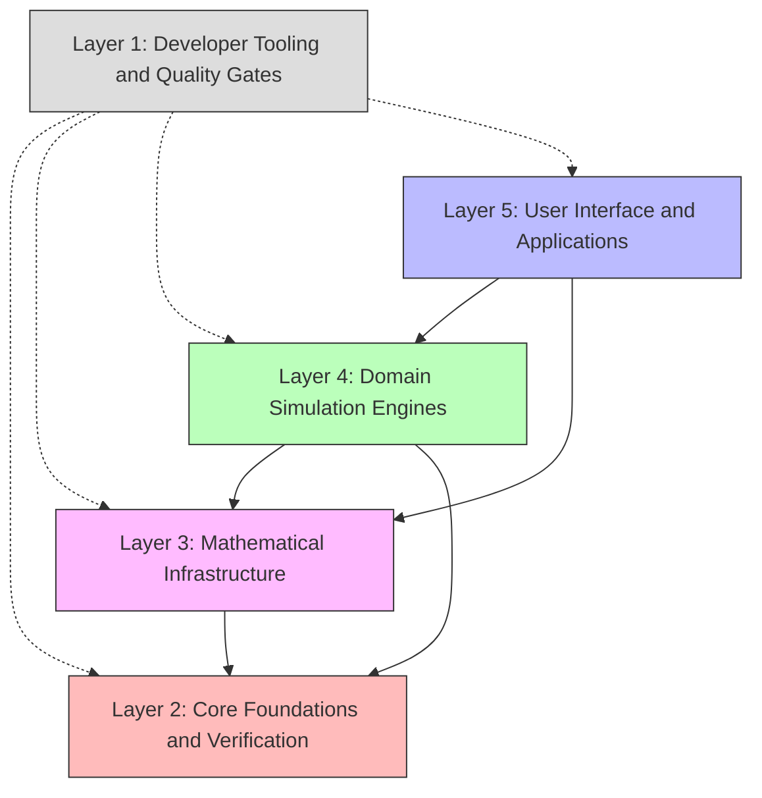
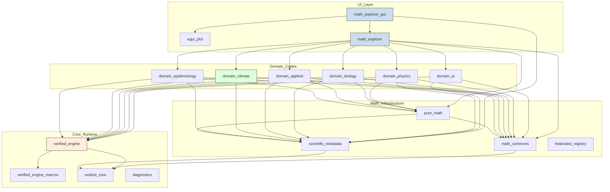

# System Overview and Crate Topology

This document describes the high-level system architecture and crate topology of OxidizeMath.

## System Architecture

OxidizeMath organizes scientific computation and interactive visualization into five clear architectural layers:

### Architectural Layers

1. **Developer Tooling (Layer 1)**: Tools execute pre-commit checks, verify code traceability, and test documentation examples.
2. **Core Foundations and Verification (Layer 2)**: Crates provide memory allocators, runtime verification, and macro definitions.
3. **Mathematical Infrastructure (Layer 3)**: Crates provide numerical types, constants, theorem metadata, and mathematical primitives.
4. **Domain Simulation Engines (Layer 4)**: Crates implement domain-specific mathematical models for AI, physics, biology, and climate.
5. **User Interface and Applications (Layer 5)**: Applications combine domain simulations into interactive visual tools.

## Crate Dependency Topology

The following Mermaid diagram shows the primary dependency graph among workspace crates:

## Workspace Crate Catalog

The workspace contains the following member crates:

| Crate Directory | Primary Role | Documentation Reference |
| :--- | :--- | :--- |
| `crates/oxidize_core` | Core utilities, file systems, and traceability | [oxidize_core](../../crates/oxidize_core/README.md) |
| `crates/verified_engine` | Zero-allocation runtime and execution tracking | [zero_allocation_runtime](zero_allocation_runtime.md) |
| `crates/verified_engine_macros` | Attribute macros (`#[theory]`, `#[verified]`) | [verified_engine](../../crates/verified_engine/src/lib.rs) |
| `crates/diagnostics` | Static analysis diagnostics and reporting | [diagnostics](../../crates/diagnostics/README.md) |
| `crates/math_commons` | Tolerances, constant registries, numeric traits | [math_commons](../../crates/math_commons/README.md) |
| `crates/pure_math` | Pure mathematics and numerical algorithms | [pure_math](../../crates/pure_math/README.md) |
| `crates/scientific_metadata` | Theory descriptors and citation metadata | [scientific_metadata](../../crates/scientific_metadata/src/lib.rs) |
| `crates/federated_registry` | Distributed model discovery and registration | [federated_registry](../../crates/federated_registry/README.md) |
| `crates/domain_ai` | Neural networks, transformers, and RL models | [domain_ai](../../crates/domain_ai/README.md) |
| `crates/domain_physics` | Fluid dynamics, quantum, and MRI models | [domain_physics](../../crates/domain_physics/README.md) |
| `crates/domain_biology` | Neuroscience, morphogenesis, and kinetics | [domain_biology](../../crates/domain_biology/README.md) |
| `crates/domain_applied` | Clinical trials, battery degradation, isosurfaces | [domain_applied](../../crates/domain_applied/README.md) |
| `crates/domain_climate` | Climate modeling and CERA framework | [cera_framework](cera_framework.md) |
| `crates/domain_epidemiology` | Compartmental disease transmission models | [domain_epidemiology](../../crates/domain_epidemiology/README.md) |
| `math_explorer` | Core library unifying domain simulation modules | [math_explorer](../../math_explorer/README.md) |
| `math_explorer_gui` | Interactive GUI for visualization and simulation | [interactive_tool_walkthrough](interactive_tool_walkthrough.md) |
| `egui_plot` | Interactive plotting library | [egui_plot](../../egui_plot/Cargo.toml) |
| `crates/markdown_tests` | Markdown test harness and doctest validation | [markdown_tests](../../crates/markdown_tests/README.md) |
| `apps/xtask` | Build automation, code generation, and linting | [xtask](../../apps/xtask/README.md) |
| `crates/unified_verification` | Unified verification and compliance gate | [unified_verification](../../crates/unified_verification/README.md) |

## Related Documentation

- [CERA Framework Guide](cera_framework.md)
- [Zero-Allocation Runtime Guide](zero_allocation_runtime.md)
- [Interactive Tool Walkthrough](interactive_tool_walkthrough.md)
- [Architecture Decision Records](../adr/0001-dynamic-workspace-discovery.md)
- [Project Contributing Guide](../../CONTRIBUTING.md)
