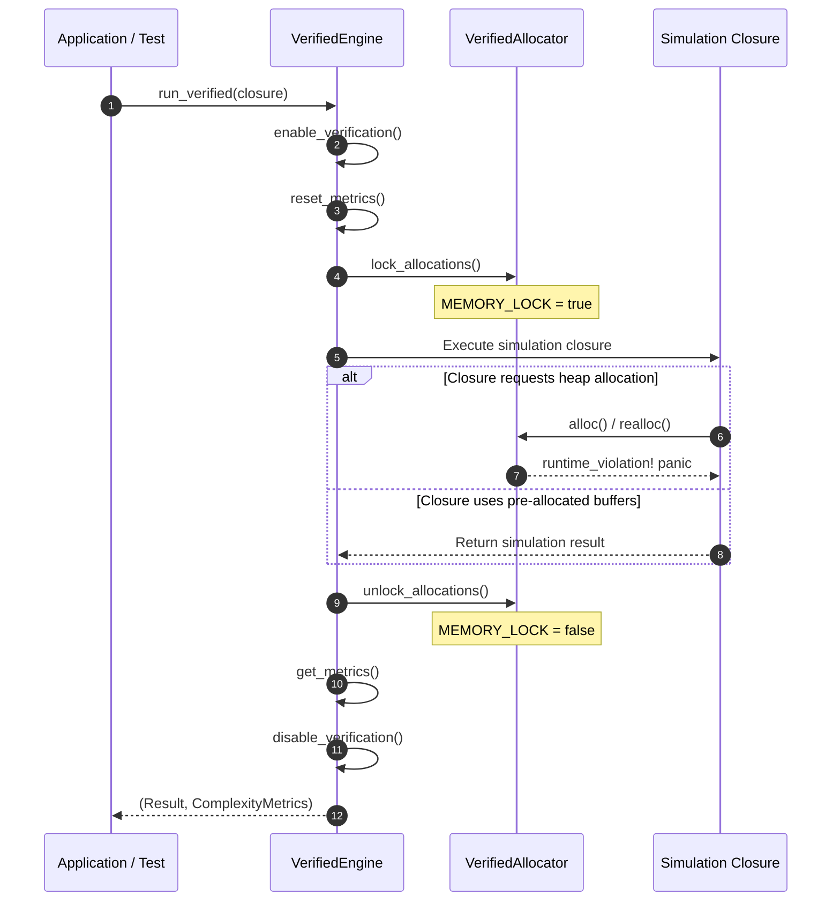

# Zero-Allocation Runtime Guide

This document describes the zero-allocation runtime verification architecture in OxidizeMath.

## Purpose

High-integrity numerical simulations require deterministic execution and bounded latency. Uncontrolled dynamic memory allocations inside inner simulation loops introduce non-deterministic execution times, heap fragmentation, and out-of-memory panics.

To eliminate these risks, OxidizeMath enforces the NASA Power of 10 Rule 3: **Do not allocate dynamic memory after initialization**.

## Architectural Model

The verified runtime architecture uses two components:

1. **`VerifiedAllocator`**: A custom global allocator wrapper around the system allocator that monitors heap requests.
2. **`VerifiedEngine`**: An execution harness that controls verification mode and records complexity metrics.



## Verification Mechanism

### Memory Lock State Machine

The module [`crates/verified_engine/src/allocator.rs`](../../crates/verified_engine/src/allocator.rs) defines the `MEMORY_LOCK` atomic flag:

- **Initialization Phase**: `MEMORY_LOCK` is `false`. Simulation setups allocate needed memory buffers, look-up tables, and state matrices.
- **Verification Phase**: `lock_allocations()` sets `MEMORY_LOCK` to `true`. Any subsequent call to `alloc`, `alloc_zeroed`, or `realloc` immediately triggers a `runtime_violation!` panic when verification is enabled.
- **Teardown Phase**: `unlock_allocations()` resets `MEMORY_LOCK` to `false` to permit normal deallocation.

### Complexity Metrics

The verified runtime also tracks arithmetic and memory complexity during verified execution:

| Metric | Field | Description |
| :--- | :--- | :--- |
| Arithmetic Operations | `ComplexityMetrics.arithmetic_ops` | Counter of floating-point operations executed. |
| Memory Loads | `ComplexityMetrics.memory_loads` | Counter of memory reads recorded in critical paths. |
| Function Calls | `ComplexityMetrics.function_calls` | Counter of internal solver invocations. |

## Code Example

The following code example shows how to run computation inside the verified runtime:

```rust
use verified_engine::engine::VerifiedEngine;

// 1. Pre-allocate all memory before entering verified execution
let mut preallocated_buffer = Vec::with_capacity(100);
for i in 0..100 {
    preallocated_buffer.push(i as f64);
}

// 2. Execute verified numerical computation without heap allocation
let (total, metrics) = VerifiedEngine::run_verified(|| {
    let mut sum = 0.0;
    for &val in &preallocated_buffer {
        sum += val;
    }
    sum
});

assert_eq!(total, 4950.0);
assert_eq!(metrics.arithmetic_ops, 0);
```

## Best Practices for Contributors

To comply with zero-allocation constraints in core simulation code:

1. **Pre-allocate Collections**: Always construct vectors with `Vec::with_capacity(n)`.
2. **Reuse Scratch Buffers**: Pass mutable references to existing storage buffers rather than returning newly allocated instances.
3. **Avoid Dynamic Formatting**: Avoid `format!` or string concatenations in inner loops.
4. **Use Fixed Arrays**: Use stack-allocated arrays (`[T; N]`) or static matrices (`SMatrix`) when array dimensions are fixed at compile time.

## Related References

- Verified engine entry point: [`crates/verified_engine/src/lib.rs`](../../crates/verified_engine/src/lib.rs)
- Verified allocator implementation: [`crates/verified_engine/src/allocator.rs`](../../crates/verified_engine/src/allocator.rs)
- Verified engine execution harness: [`crates/verified_engine/src/engine.rs`](../../crates/verified_engine/src/engine.rs)
- Metrics tracking implementation: [`crates/verified_engine/src/metrics.rs`](../../crates/verified_engine/src/metrics.rs)
- [System Overview](system_overview.md)
