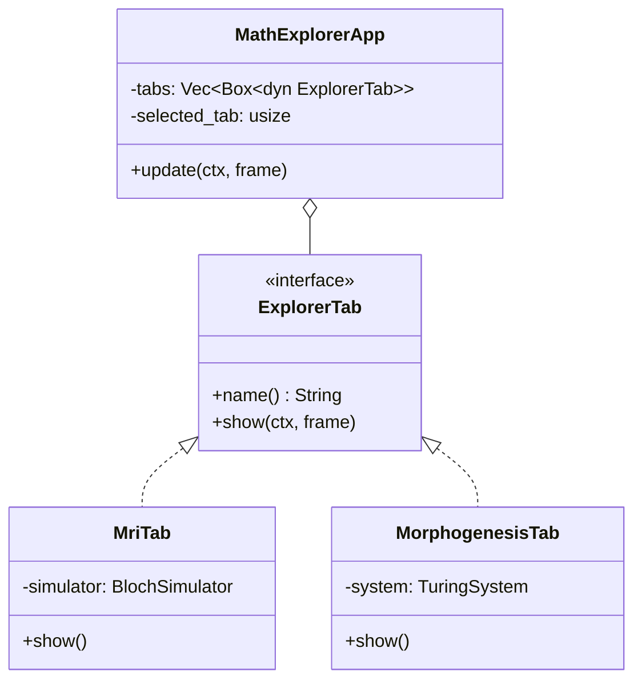

# Math Explorer GUI


The graphical front-end for the `math_explorer` library, built using `eframe` (egui framework).

##  Install

Ensure you have the Rust toolchain installed. This crate is part of the `math_explorer` workspace.

```bash
git clone https://github.com/fderuiter/OxidizeMath.git
cd OxidizeMath
```

##  Usage

### Desktop (Native)

To run the interactive application natively:

```bash
cargo run --release --package math_explorer_gui
```

### Web (WASM)

To compile and run the application in your browser (requires Trunk):

```bash
# 1. Install Trunk and WASM target
cargo install trunk
rustup target add wasm32-unknown-unknown

# 2. Serve the application locally
cd math_explorer_gui
trunk serve
```

##  Config (Architecture)

The GUI follows a modular architecture based on the `ExplorerTab` trait. The main application `MathExplorerApp` manages a list of these tabs and handles navigation.



### Key Components

*   **`MathExplorerApp`**: The root component implementing `eframe::App`. It renders the top navigation bar and delegates the main content area to the active tab.
*   **`ExplorerTab`**: The trait that all visualization modules must implement. It provides a standard interface for the app to interact with different simulations.
*   **`math_explorer` Dependency**: All heavy mathematical logic (physics, biology, etc.) resides in the core `math_explorer` crate. The GUI crate should focus **only** on visualization and input handling.

##  Contributing

Follow these steps to add a new visualization tab or simulation tool to `math_explorer_gui`.

### 1. Create the Tab Module
Create either a single file `src/tabs/<tab_name>.rs` or a directory `src/tabs/<tab_name>/mod.rs` implementing `ExplorerTab` and `Default`. Optional header directives configure Cargo feature gating (`// @explorer_feature = "<domain>"`) and navigation ordering (`// @explorer_order = <n>`):

```rust,ignore
#![cfg_attr(any(), verified(opt_out = "gui_tool"))]
// @explorer_feature = "physics"
// @explorer_order = 10

use crate::tabs::ExplorerTab;
use eframe::egui;

#[derive(Default)]
pub struct FluidDynamicsTab {
    velocity: f64,
}

impl ExplorerTab for FluidDynamicsTab {
    fn name(&self) -> &'static str {
        "Fluid Dynamics"
    }

    fn show_inside(&mut self, ui: &mut egui::Ui, _frame: &mut eframe::Frame) {
        egui::CentralPanel::default().show_inside(ui, |ui| {
            ui.heading("Fluid Simulation");
            ui.add(egui::Slider::new(&mut self.velocity, 0.0..=100.0).text("Velocity"));
        });
    }
}
```

### 2. Automatic Build-Time Discovery (`build.rs`)
Do **not** manually register your tab inside `src/tabs/mod.rs` or edit application startup files (`src/app/mod.rs`). During compilation, [`math_explorer_gui/build.rs`](build.rs) automatically scans `src/tabs/` (and workspace path dependencies) for `impl ExplorerTab for <Struct>` definitions and generates `$OUT_DIR/generated_tabs.rs` (`instantiate_tabs()` and `instantiate_tab()`), which [`src/tabs/mod.rs`](src/tabs/mod.rs) includes automatically.

### 3. Adding Interactive Tools Within a Domain Tab
Most multi-tool domain tabs wrap `SimulationFramework::new("<domain>")` and discover individual tools via `inventory::submit!`. To add a new simulation tool (implementing `InteractiveTool` and `TheoryDescribable`) inside an existing domain folder (`src/tabs/<domain>/<tool>.rs`), declare `pub mod <tool>;` in `src/tabs/<domain>/mod.rs` and follow the step-by-step [Interactive Tool Walkthrough](../docs/architecture/interactive_tool_walkthrough.md).

### Design Principles

1.  **Separation of Concerns**: Keep simulation logic in `math_explorer`. If you need a new simulation model, add it to the core library first, then visualize it here.
2.  **Immediate Mode**: `egui` is an immediate mode GUI. This means the `show()` function is called every frame. Avoid heavy computations directly in `show()`. Use a separate thread or perform small updates per frame.
3.  **No Heavy Dependencies**: We try to keep the GUI crate lightweight. Avoid adding heavy dependencies like `rand` if a simple internal implementation or a dependency from `math_explorer` suffices.
