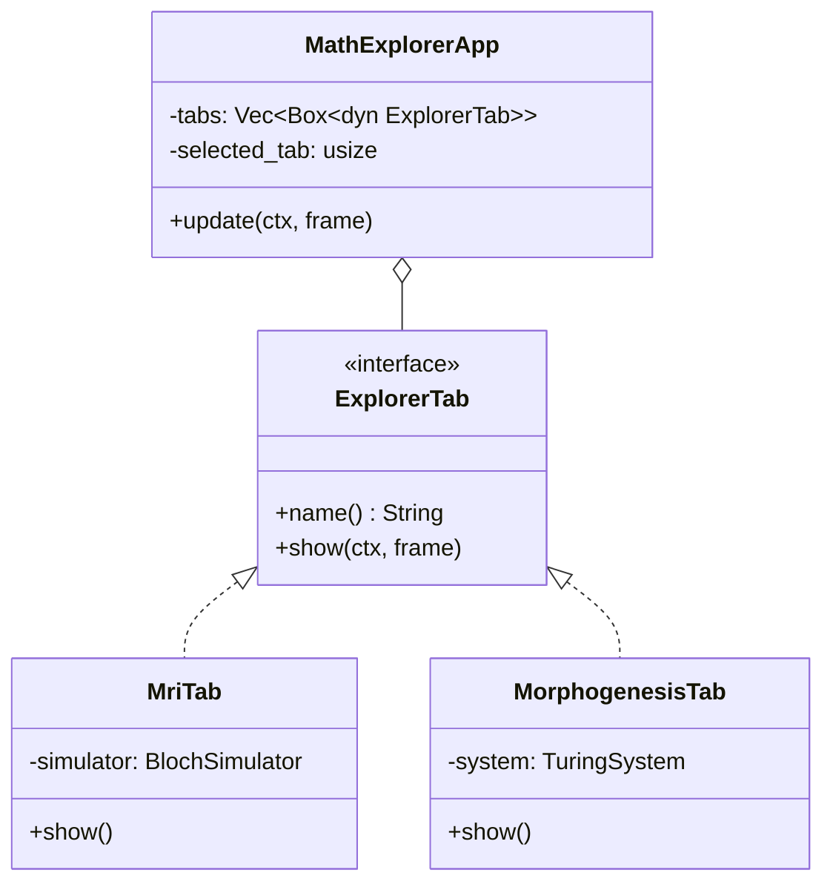

# Math Explorer GUI


Interactive desktop and WebAssembly graphical workbench for exploring OxidizeMath simulations with `eframe` and `egui`.

## 1. Overview & Architecture

The `math_explorer_gui` crate provides the immediate-mode graphical frontend for `math_explorer` across native desktop targets and WebAssembly (`wasm32-unknown-unknown`). It pairs modular simulation tabs with background worker execution, WCAG-aligned semantic palettes, AccessKit screen-reader bridges, URL-shareable preset state, and scientific theory sidecars.



### Key Components

- **`MathExplorerApp`**: Root `eframe::App` shell managing navigation, starter gallery workflows, command palette search, accessibility announcements, and active workspace panels.
- **`framework` & `tabs`**: Modular interactive tools implementing `InteractiveTool` / `ExplorerTab` contracts while delegating all mathematical computation to `math_explorer`.
- **`async_sim`**: Off-thread and Web Worker simulation runners preventing frame-budget stalls during heavy PDE, FFT, or Monte Carlo sweeps.
- **`presets` & `url_state`**: Versioned JSON preset import/export and deterministic URL state encoding.

---

## 2. Developer Instructions

### Running Desktop (Native) and Web (WASM)

```bash
# Run the native desktop application
cargo run --release --package math_explorer_gui

# Serve the WebAssembly application locally (requires trunk and wasm32-unknown-unknown)
rustup target add wasm32-unknown-unknown
cd math_explorer_gui
trunk serve
```

### Adding a New Visualization Tab

Follow the [Interactive Tool Walkthrough](../docs/architecture/interactive_tool_walkthrough.md) when adding a new simulation tool:

1. **Create the Tab Module** (`src/tabs/fluid_dynamics.rs` or `src/tabs/fluid_dynamics/mod.rs`):

```text
use crate::tabs::ExplorerTab;
use eframe::egui;

pub struct FluidDynamicsTab {
    velocity: f64,
}

impl Default for FluidDynamicsTab {
    fn default() -> Self {
        Self { velocity: 0.0 }
    }
}

impl ExplorerTab for FluidDynamicsTab {
    fn name(&self) -> &'static str {
        "Fluid Dynamics"
    }

    fn show(&mut self, ctx: &egui::Context, _frame: &mut eframe::Frame) {
        egui::CentralPanel::default().show(ctx, |ui| {
            ui.heading("Fluid Simulation");
            ui.add(egui::Slider::new(&mut self.velocity, 0.0..=100.0).text("Velocity"));
        });
    }
}
```

2. **Register the Module & Preset Metadata**: Export the tab under `src/tabs/` and register its starter gallery preset and URL state descriptors.
3. **Design Principles**:
   - **Separation of Concerns**: Keep mathematical solvers and domain physics inside `math_explorer` domain crates; keep GUI code focused on visualization and interaction.
   - **Frame-Budget Safety**: Avoid heavy synchronous PDE/FFT work in `Default::default()` or per-frame `show()` calls; offload expensive sweeps via `async_sim`.

---

## 3. Ecosystem Integration

`math_explorer_gui` consumes domain models solely through `math_explorer`, renders interactive 2D/3D plots via the workspace `egui_plot` crate, and wires runtime alerts through `diagnostics` and `federated_registry`.
