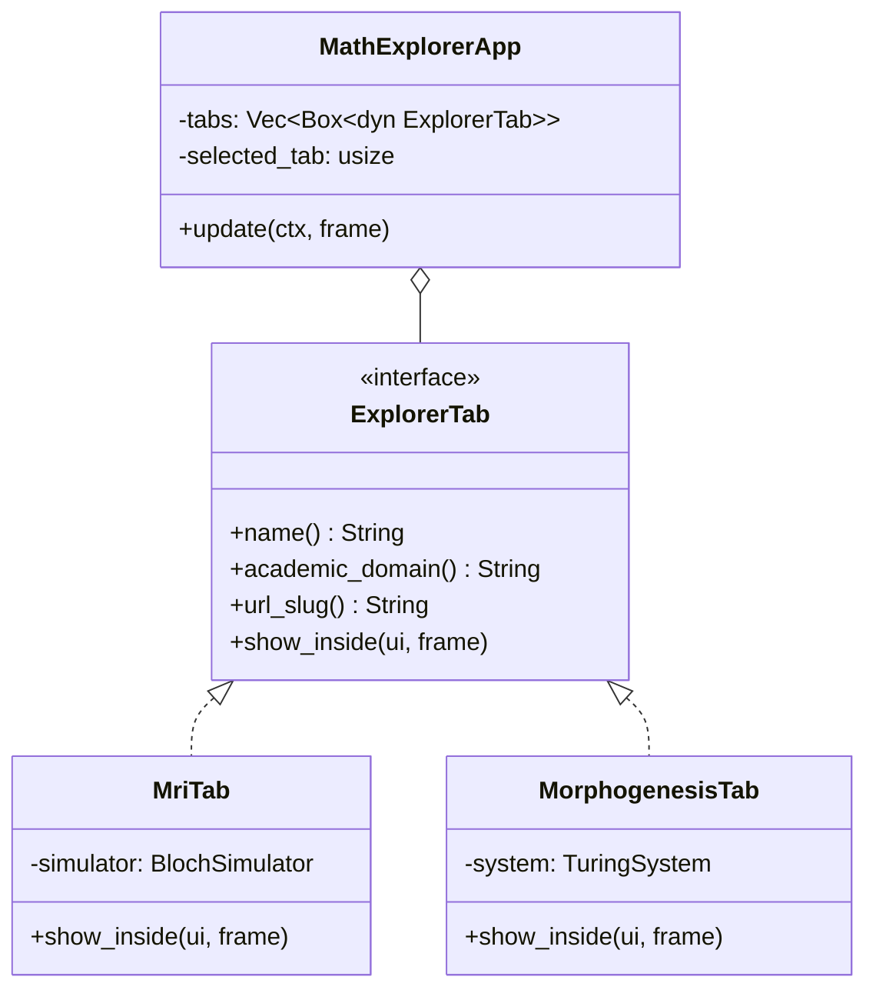

# Math Explorer GUI


Interactive desktop and WebAssembly graphical workbench for exploring OxidizeMath simulations with `eframe` and `egui`.

## 1. Overview & Architecture

The `math_explorer_gui` crate provides the immediate-mode graphical frontend for `math_explorer` across native desktop targets and WebAssembly (`wasm32-unknown-unknown`). It pairs modular simulation tabs with background worker execution, WCAG-aligned semantic palettes, AccessKit screen-reader bridges, URL-shareable preset state, and scientific theory sidecars.



### Key Components

- **`MathExplorerApp`**: Root `eframe::App` shell managing navigation, starter gallery workflows, command palette search, accessibility announcements, and delegating each viewport pane's scoped `egui::Ui` to the active tab via `ExplorerTab::show_inside`.
- **`ExplorerTab` & `framework`**: Standard visualization trait and interactive tool framework supporting single-pane and multi-pane layouts while delegating all mathematical computation to `math_explorer`.
- **`async_sim`**: Off-thread and Web Worker simulation runners preventing frame-budget stalls during heavy PDE, FFT, or Monte Carlo sweeps.
- **`presets` & `url_state`**: Versioned JSON preset import/export and deterministic URL state encoding.

---

## 2. Developer Instructions

### Running Desktop (Native) and Web (WASM)

```bash
# Run the native desktop application
cargo run --release --package math_explorer_gui

# Serve the WebAssembly application locally (requires trunk and wasm32-unknown-unknown)
rustup target add wasm32-unknown-unknown
cd math_explorer_gui
trunk serve
```

### Adding a New Visualization Tab

Follow these steps to add a new visualization tab or simulation tool to `math_explorer_gui`.

#### 1. Create the Tab Module
Create either a single file `src/tabs/<tab_name>.rs` or a directory `src/tabs/<tab_name>/mod.rs`. Every top-level tab module must declare `// @explorer_domain = "<Domain>"` and `// @explorer_slug = "<slug>"`, with optional directives for Cargo feature gating (`// @explorer_feature = "<domain>"`) and navigation ordering (`// @explorer_order = <n>`).

For standard `SimulationFramework` domain tabs, use `crate::declare_simulation_tab!`:

```rust,ignore
#![cfg_attr(any(), verified(opt_out = "gui_tool"))]
// @explorer_feature = "physics"
// @explorer_order = 10
// @explorer_domain = "Physics"
// @explorer_slug = "fluid"

pub mod navier_stokes;

crate::declare_simulation_tab! {
    /// Fluid Dynamics Interactive Explorer.
    pub struct FluidDynamicsTab {
        name: "Fluid Dynamics",
        framework_domain: "fluid_dynamics",
    }
}
```

For custom single-view or bespoke panels, implement `ExplorerTab` and `Default` directly, returning the generated `EXPLORER_DOMAIN` and `EXPLORER_SLUG` module constants:

```rust,ignore
#![cfg_attr(any(), verified(opt_out = "gui_tool"))]
// @explorer_feature = "physics"
// @explorer_order = 10
// @explorer_domain = "Physics"
// @explorer_slug = "fluid"

use crate::tabs::ExplorerTab;
use eframe::egui;

#[derive(Default)]
pub struct FluidDynamicsTab {
    velocity: f64,
}

impl ExplorerTab for FluidDynamicsTab {
    fn name(&self) -> &'static str {
        "Fluid Dynamics"
    }

    fn academic_domain(&self) -> &'static str {
        EXPLORER_DOMAIN
    }

    fn url_slug(&self) -> &'static str {
        EXPLORER_SLUG
    }

    fn show_inside(&mut self, ui: &mut egui::Ui, _frame: &mut eframe::Frame) {
        egui::CentralPanel::default().show_inside(ui, |ui| {
            ui.heading("Fluid Simulation");
            ui.add(egui::Slider::new(&mut self.velocity, 0.0..=100.0).text("Velocity"));
        });
    }
}
```

#### 2. Automated Plugin Discovery (`build.rs`)
Do **not** manually edit `src/tabs/mod.rs` or `src/app/mod.rs` to register your new tab. At compile time, [`build.rs`](build.rs) automatically scans `src/tabs/` for `crate::declare_simulation_tab!` or `impl ExplorerTab for <Struct>` definitions (requiring `Default`), validates unique URL slugs, and generates `$OUT_DIR/generated_tabs.rs` (`EXPLORER_DOMAIN`, `EXPLORER_SLUG`, `instantiate_tabs()`, and `instantiate_tab()`), which [`src/tabs/mod.rs`](src/tabs/mod.rs) includes automatically:

- `// @explorer_domain = "Physics"`: Required header comment specifying the `AcademicDomain` category.
- `// @explorer_slug = "fluid"`: Required header comment specifying a unique URL state slug (cannot be `"simulation"`).
- `// @explorer_feature = "physics"`: Optional header comment gating the module behind a Cargo feature.
- `// @explorer_order = 10`: Optional header comment controlling navigation bar sort order (lower numbers appear first).

#### 3. Adding Interactive Tools Within a Domain Tab
Most multi-tool domain tabs wrap `SimulationFramework::new("<domain>")` and discover individual tools via `inventory::submit!`. To add a new simulation tool (implementing `InteractiveTool` and `TheoryDescribable`) inside an existing domain folder (`src/tabs/<domain>/<tool>.rs`), declare `pub mod <tool>;` in `src/tabs/<domain>/mod.rs` and follow the step-by-step [Interactive Tool Walkthrough](../docs/architecture/interactive_tool_walkthrough.md).

#### 4. Design Principles
- **Separation of Concerns**: Keep mathematical solvers and domain physics inside `math_explorer`; keep GUI code focused on visualization and input handling.
- **Immediate Mode & Frame-Budget Safety**: `show_inside()` runs every frame. Avoid heavy synchronous PDE/FFT work in `Default::default()` or `show_inside()`; offload expensive sweeps via `async_sim`.
- **Lightweight Dependencies**: Avoid adding heavy dependencies (such as direct `rand`) when `math_explorer` primitives suffice.

---

## 3. Ecosystem Integration

`math_explorer_gui` consumes domain models solely through `math_explorer`, renders interactive 2D/3D plots via the workspace `egui_plot` crate, and wires runtime alerts through `diagnostics` and `federated_registry`.
